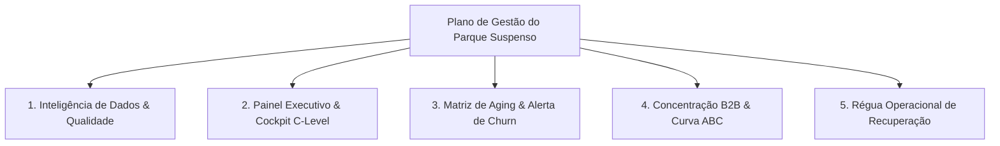

# Plano de Ação & Relatório de Status: Gestão de Parque Suspenso

**Projeto:** Dashboard Executivo de Gestão e Monitoramento de Parque Suspenso  
**Segmento:** Linhas Corporativas (B2B)  
**Base Analisada:** Janeiro a Maio de 2026 (Consolidado: 2.061 registros após deduplicação | 821 clientes | 15 UFs)  
**Última atualização:** 19/10/2026 — Rodada 6 (README completo e limpeza do diretório)

---

## 1. Plano de Ação Estratégico

### Objetivo Principal
Reduzir o **Churn Involuntário** (desconexão definitiva por inadimplência), dar visibilidade executiva à evolução do parque de linhas bloqueadas e otimizar a esteira de cobrança/recuperação antes que os contratos atinjam o limite irreversível de cancelamento pela operadora (60 a 90 dias).

### Pilares de Atuação


1. **Inteligência de Dados & Qualidade:** Saneamento contínuo das informações de cadastro, telefonia, datas de ativação e envelhecimento da dívida, mantendo anonimizados os identificadores corporativos restritos.
2. **Cockpit Executivo:** Acompanhamento mensal consolidado com KPIs macro (Volume de Linhas, Clientes Afetados, Taxa de Inadimplência, % Aging Crítico e Variação MoM).
3. **Matriz de Aging & Risco de Churn:** Priorização de ação por janelas de oportunidade:
   - **0 a 30 dias (Janela de Ouro):** Maior taxa de recuperação e menor custo de contato.
   - **31 a 60 dias (Atenção):** Risco intermediário.
   - **61 a 90 dias (Risco Crítico):** Última oportunidade de negociação antes da baixa definitiva.
   - **> 90 dias (Pré-Desconexão):** Ações extraordinárias de repactuação.
4. **Concentração B2B (Pareto):** Foco nos grandes devedores, onde poucos CNPJs concentram dezenas de linhas simultâneas.
5. **Régua Operacional:** Acionamento dinâmico via canais digitais (WhatsApp / Telefone) com mensagens padronizadas.

---

## 2. O Que Já Foi Feito (Entregas Concluídas)

### ✅ Diagnóstico e Profiling dos Dados
- Mapeamento e consolidação dos arquivos mensais (`ParqueSuspenso_janeiro.csv` a `ParqueSuspenso_maio.csv`) e do consolidado `parquesuspenso-janeiro a maio.csv`.
- Identificação da planilha `parquesuspenso-janeiro a maio.xlsx` como arquivo vazio (descartado do pipeline).
- Descoberta e isolamento do pico de Abril/2026 e normalização em Maio/2026 (472 linhas). **Diagnóstico posterior (19/10/2026):** o "pico" de Abril era um artefato de carga duplicada (1.519 → 509 linhas reais); corrigido automaticamente no ETL.

### ✅ Saneamento e Engenharia de Dados (ETL)
- **Recuperação de 100% das UFs ausentes:** Os 227 registros sem estado foram enriquecidos através do DDD de origem (`84` mapeado para **RN** e `89` mapeado para **PI**), integrando o Rio Grande do Norte ao painel.
- Padronização de encoding (remoção de caracteres BOM e correção de acentuações como *Até 30 dias*, *De 31 a 60 dias*).
- Tratamento e formatação de máscaras de CNPJ (`XX.XXX.XXX/XXXX-XX`) e telefones.
- Geração das bases tratadas de alta performance:
  - [`parque_suspenso_tratado.parquet`](file:///C:/Users/lcost/Documents/Codigos/Projetos%20lv1/dashboads03/parque_suspenso_tratado.parquet) (Carregamento instantâneo via memória).
  - [`parque_suspenso_tratado.csv`](file:///C:/Users/lcost/Documents/Codigos/Projetos%20lv1/dashboads03/parque_suspenso_tratado.csv) (Exportação auditável em UTF-8 com BOM).

### ✅ Anonimização e Remoção de Identificadores Corporativos
- Remoção completa de:
  - `DEALEAR` (*"AVANTTI TELECOMUNICACOES"*)
  - `CD_DEALER` (*"ALP0115-001"*)
  - `NOME_DIRETOR` (*"CLAUDIO RIBEIRO DE JESUS"*)
  - `NOME_DIVISAO` (*"LUIS OTAVIO CAVALCANTI MONTIBELO"*)
- Todos os títulos, cabeçalhos, rodapés e templates de mensagens foram generalizados para visual neutro e executivo.

### ✅ Construção do Dashboard Executivo (Streamlit + Plotly)
- Desenvolvimento do código principal em [`app.py`](file:///C:/Users/lcost/Documents/Codigos/Projetos%20lv1/dashboads03/app.py).
- Implementação de Design System Corporativo em Dark Theme (tons *Slate 900*, *Navy*, acentos em *Cyan* e *Coral*).
- **5 Painéis Interativos Desenvolvidos:**
  1. **Cockpit Executivo:** 5 KPI cards com variação MoM, gráfico histórico Jan-Mai empilhado por status, rosca de aging e distribuição de materiais/severidade.
  2. **Aging & Risco de Churn:** Cartões por faixa de criticidade, gráfico de dispersão (*Tenure da Linha* vs. *Dias em Suspensão*) e tabela com as linhas mais antigas em atraso.
  3. **Top Contas & Pareto:** Curva ABC acumulada, ranking Top 10 e seletor com drill-down completo da ficha do cliente.
  4. **Inteligência Geográfica:** Ranking de estados (liderados por BA, AL, PE, CE, RN) e distribuição por DDD.
  5. **Régua de Cobrança & Ações:** Gerador de mensagens prontas com link direto para WhatsApp e botão de download da base filtrada em CSV.

### ✅ Automação de Inicialização & Configuração
- Criação do arquivo [`.streamlit/config.toml`](file:///C:/Users/lcost/Documents/Codigos/Projetos%20lv1/dashboads03/.streamlit/config.toml) para forçar o tema escuro sem depender do navegador.
- Criação do script executável em lote [`iniciar_dashboard.bat`](file:///C:/Users/lcost/Documents/Codigos/Projetos%20lv1/dashboads03/iniciar_dashboard.bat) para subida em 1-clique no Windows.
- Aplicação validada e em execução em `http://localhost:8503`.

### ✅ Rodada 2 — Entregas de 18/10/2026 (Backlog de Prioridade Alta e Média)

**1. 💰 Estimativa de Impacto Financeiro (MRR em Risco)**
- Novo campo configurável na sidebar: **Ticket Médio Mensal por Linha** (padrão R$ 45, faixa R$ 10–300).
- 6º KPI card no Cockpit: **MRR em Risco** com projeção anualizada e ticket aplicado.
- Novo painel na aba *Aging & Risco de Churn*: **MRR em Risco por Faixa de Aging** (gráfico + cartões de "Dinheiro Recuperável na Janela de Ouro" e "MRR em Zona Irreversível >60d").
- Todos os valores são recalculados dinamicamente conforme o ticket e os filtros globais.

**2. 🔄 Ingestão Automática de Próximos Meses**
- `etl_pipeline.py` agora é *month-agnostic*: detecta qualquer `ParqueSuspenso_*.csv` na pasta (ex.: `ParqueSuspenso_junho.csv`), identifica o mês pela coluna `REFERENCIA` (ou pelo nome do arquivo) e o anexa automaticamente ao consolidado.
- Verificação automática ao abrir o dashboard + botão **"🔄 Atualizar Base / Detectar Novos Meses"** na sidebar.
- Eixo temporal, seletor de meses, variação MoM e gráfico histórico passaram a ser **gerados dinamicamente** (sem listas fixas de Jan–Mai).
- **Teste end-to-end validado:** arquivo simulado de Jun/2026 foi detectado, ingerido e removido, com restauração da base original (3.071 registros).

**3. 📕 Relatório Executivo em PDF (Página Única)**
- Novo módulo [`relatorio_pdf.py`](file:///C:/Users/lcost/Documents/Codigos/Projetos%20lv1/dashboads03/relatorio_pdf.py) com layout A4 paisagem: 6 KPI cards, MRR em risco por faixa, distribuição de aging e Top 10 clientes.
- Botão **"📕 Baixar Relatório Executivo (PDF)"** na aba *Régua de Cobrança & Ações*, sempre respeitando o recorte de filtros ativo.
- Layout validado visualmente (renderização em imagem) e conteúdo alinhado à política de anonimização.

**4. 🎯 Metas e SLAs de Recuperação**
- Sliders na sidebar para metas de normalização: **0-30 dias (padrão 60%)** e **31-60 dias (padrão 40%)**.
- Painel "Metas & SLA de Recuperação do Mês" na aba *Aging & Risco de Churn*: % realizado vs. meta, linhas normalizadas e barras de progresso comparando o mês selecionado ao anterior.

**5. 🧹 Correção de Anonimização no Pipeline**
- As colunas `DEALEAR`, `CD_DEALER`, `NOME_DIRETOR` e `NOME_DIVISAO` ainda persistiam no Parquet/CSV apesar de constarem como removidas. O ETL agora as descarta explicitamente na gravação (validado: ausentes na base final).

**6. 🧰 Robustez de Ambiente**
- Criação do [`requirements.txt`](file:///C:/Users/lcost/Documents/Codigos/Projetos%20lv1/dashboads03/requirements.txt) com as dependências do projeto.
- `iniciar_dashboard.bat` atualizado: valida/instala dependências, checa novos meses antes de subir e evita execução desnecessária do ETL completo.
- Migração dos parâmetros `use_container_width` para `width='stretch'` (API atual do Streamlit 1.66).
- **Testes:** `AppTest` executado com sucesso em 5 cenários (mês default, consolidado, Abr/2026, ticket R$ 60, meta 80%) — **zero exceções**.

### ✅ Rodada 3 — Fase 1 do Plano de Melhorias (19/10/2026)

Conforme [`ANALISE_E_PLANO_DE_MELHORIAS.md`](file:///C:/Users/lcost/Documents/Codigos/Projetos%20lv1/dashboads03/ANALISE_E_PLANO_DE_MELHORIAS.md) (correções críticas):

**1. 🔒 Segurança**
- Auditoria confirmou que **não existe `.env` nem credenciais** no projeto (o alerta da análise era falso positivo) e que **não há repositório git**.
- Criado [`.gitignore`](file:///C:/Users/lcost/Documents/Codigos/Projetos%20lv1/dashboads03/.gitignore) preventivo (segredos, `secrets.toml`, chaves, `__pycache__`, `logs/`, artefatos gerados).

**2. 📊 Validação de Dados no ETL**
- `validar_base()` audita estrutura e qualidade: colunas obrigatórias/derivadas, faixa de `REFERENCIA` (AAAAmm), telefones curtos/nulos, datas inválidas/futuras/antigas, CNPJ nulo e duplicatas.
- Exceção dedicada `ETLValidationError` para falhas fatais (base vazia, colunas ausentes, referência inválida).
- Roda em 3 pontos: entrada consolidada → pós-ingestão de novos meses → base tratada final.

**3. 📝 Logging Estruturado**
- Novo módulo [`logging_config.py`](file:///C:/Users/lcost/Documents/Codigos/Projetos%20lv1/dashboads03/logging_config.py): console + arquivo rotativo `logs/parque_suspenso.log` (2 MB × 3 backups), com helper `mascarar()` para ofuscar telefone/CNPJ.
- `print()` substituídos por logs com níveis em `etl_pipeline.py`, `app.py` e `relatorio_pdf.py`.

**4. 🛡️ Tratamento de Erros Robusto**
- `run_etl()` encapsula a execução com `log.exception` e re-lançamento controlado.
- App valida a estrutura da base carregada, exibe mensagem clara ao usuário e registra o traceback apenas no log.
- Auto-recuperação: base tratada ausente/incompleta dispara reexecução automática do ETL.
- Endurecimento: `.mode()` seguro (evita erro com NaN), escape de HTML nos dados renderizados e bloqueio de link de WhatsApp sem telefone válido.

**5. 🧹 Limpeza Técnica**
- Removido o dicionário estático `REF_TO_LABEL` (código morto); toda conversão usa `ref_to_label()` dinâmica.

**Evidências:** 6/6 testes de validação PASS · 8/8 cenários de UI PASS (`AppTest`) · auto-recuperação e erro controlado validados · base final íntegra (3.071 registros / 5 meses).

**Achado novo (para a Fase 2):** a validação revelou **1.010 registros duplicados** por (`NUMTELEFONE`, `REFERENCIA`, `STATUS`, `AGING`) na base consolidada — a decidir com a regra de negócio (provável repetição por material/débito).

### ✅ Rodada 4 — Fase 2 do Plano de Melhorias: Performance & UX (19/10/2026)

Conforme [`ANALISE_E_PLANO_DE_MELHORIAS.md`](file:///C:/Users/lcost/Documents/Codigos/Projetos%20lv1/dashboads03/ANALISE_E_PLANO_DE_MELHORIAS.md) (otimizações):

**1. ⚡ Cache granular — novo módulo [`app_data.py`](file:///C:/Users/lcost/Documents/Codigos/Projetos%20lv1/dashboads03/app_data.py)**
- Agregações `@st.cache_data`: KPIs macro, faixas de risco, financeiro por faixa, ranking de clientes (Pareto) e geografia (UF/DDD).
- Antes esses `groupby` eram recalculados a cada interação; agora são calculados uma vez e reutilizados entre painéis.
- Geração do PDF também passou a ser **cacheada** (`pdf_do_recorte`) — só reconstrói quando o recorte muda.

**2. 🗂️ Lazy loading real de painéis**
- Navegação migrada de `st.tabs` (que renderiza todas as abas sempre) para `st.pills`: **apenas o painel ativo é construído**.
- A opção **🗂️ Todos os Painéis** mantém o comportamento clássico para quem prefere ver tudo de uma vez.

**3. 🧩 Fragments (UX de interação)**
- Ficha do cliente (drill-down) e gerador de WhatsApp viraram `@st.fragment`: interagir com os seletores re-executa **apenas aquele bloco**, sem reprocessar o dashboard.

**4. 🌀 Loading states**
- Spinner no botão de atualização, `st.toast` quando não há mês novo, log estruturado por render de painel e badge **🧹 Deduplicado** no cabeçalho quando o filtro está ativo.

**5. 🔎 Achado crítico de qualidade de dados (diagnóstico investigado)**
- Os **1.010 registros duplicados são linhas 100% idênticas e estão TODOS em Abr/2026**: o mês foi carregado **3×** no arquivo de origem (1.519 → **509 linhas reais**). O "pico de Abril" é, portanto, um artefato de carga — não crescimento real.
- **Tratamento não destrutivo:** aviso na sidebar + *expander* explicativo no Cockpit + toggle opcional **🧹 Deduplicar registros exatos** (padrão desligado). A base não foi alterada.
- **Recomendação:** corrigir o arquivo de origem e reexecutar o ETL (ver pendências da Fase 3).

**Evidências:** 10/10 cenários de UI PASS (`AppTest`, incluindo o modo "Todos os Painéis" e deduplicação) · troca de painel entre **186–815 ms** (antes, todos os painéis por interação) · revisita com cache **182 ms** · interação em fragment **145 ms** · zero exceções.

### ✅ Rodada 5 — Correção Definitiva do Pico de Abril/2026 (19/10/2026)

Com o diagnóstico confirmado (duplicação de carga, não crescimento real), a correção foi aplicada **no pipeline de ETL**, tornando-a permanente e automática:

**1. 🧹 Deduplicação no ETL**
- Nova etapa `remover_duplicatas_exatas()` + flag `REMOVER_DUPLICATAS_EXATAS = True` (configurável) em [`etl_pipeline.py`](file:///C:/Users/lcost/Documents/Codigos/Projetos%20lv1/dashboads03/etl_pipeline.py).
- Remove **apenas linhas 100% idênticas** (nenhuma informação de negócio é perdida) e registra em log o total removido **detalhado por mês**.
- Roda após a ingestão automática de novos meses — ou seja, qualquer mês novo com carga duplicada é corrigido sem intervenção manual.

**2. 📉 Impacto na base**

| Métrica | Antes | Depois |
|---|---:|---:|
| Registros totais | 3.071 | **2.061** |
| Duplicatas exatas | 1.010 | **0** |
| Abr/2026 | 1.519 (inflado) | **509 (real)** |
| Validação da base tratada | 1 alerta de qualidade | **sem alertas** |

Com a base corrigida, a evolução histórica passa a ser coerente: Jan 348 → Fev 363 → Mar 369 → **Abr 509** → Mai 472. A anotação automática de "pico anômalo" no gráfico deixa de aparecer (ela só é exibida quando um mês supera 1,5× a média).

**3. 🔁 Simplificação do dashboard**
- O toggle manual de deduplicação foi removido (deixou de ser necessário, pois a base já chega limpa).
- Mantido apenas um **alerta defensivo**: se um Parquet antigo/restaurado contiver duplicatas, a sidebar avisa e orienta a reexecutar o ETL.

**Evidências:** 10/10 cenários PASS (`AppTest`: 5 painéis, modo "Todos", recortes consolidado/Abril, filtro vazio) · base 2.061 registros / 0 duplicatas / 821 clientes / 15 UFs · **nenhuma** coluna anonimizada presente · anotação de pico ausente (confirmado).

**Observação (higiene opcional):** o arquivo de origem `parquesuspenso-janeiro a maio.csv` ainda contém as linhas repetidas. Como o ETL já as neutraliza automaticamente, não é necessário corrigi-lo — mas reexportá-lo limpo tornaria a origem consistente com a base tratada.

### ✅ Rodada 6 — Documentação e Limpeza do Diretório (19/10/2026)

**1. 📖 Novo [`README.md`](file:///C:/Users/lcost/Documents/Codigos/Projetos%20lv1/dashboads03/README.md)**
Documentação central do projeto com: visão geral, status atual, início rápido (1 clique e CLI), estrutura de arquivos, arquitetura e fluxo de dados, etapas do ETL, regras de negócio (aging, faixas de risco, MRR, metas), descrição dos painéis, central de alertas, ingestão de novos meses, qualidade de dados, anonimização, logs, solução de problemas, validação e roadmap.

**2. 🧹 Varredura e limpeza do diretório**

| Arquivo removido | Motivo |
|---|---|
| `parquesuspenso-janeiro a maio.xlsx` | Arquivo **completamente em branco** (planilha `Sheet1` sem nenhum dado) e **não referenciado** por nenhum código. |
| `__pycache__/` | Cache de bytecode gerado automaticamente pelo Python (recriado sob demanda; já coberto pelo `.gitignore`). |

**3. ✅ Verificação de arquivos mantidos**
Todos os demais arquivos foram conferidos por referência no código: a base consolidada e os 5 arquivos mensais são usados pelo ETL (ingestão automática + mensagens de exemplo), as bases tratadas são consumidas pelo dashboard, e `logs/`, `.streamlit/` e `.gitignore` são de runtime/configuração. **Nenhum arquivo órfão restante.**


---

### ✅ Rodada 7 — Rastreador Nominal de Recuperação (19/10/2026)

**1. 📞 Módulo [`rastreador.py`](file:///C:/Users/lcost/Documents/Codigos/Projetos%20lv1/dashboads03/rastreador.py)**
Persistência **append-only** em `acoes_recuperacao.csv` (delimitado por `;`, UTF-8 com BOM), com IDs sequenciais (`A00001`), validação de domínio (`AcaoInvalidaError`) e leitura tolerante a arquivo ausente/parcial.

**2. 📊 Novo painel *📞 Rastreador de Recuperação***
KPIs (ações, conversão, 1º contato médio, aderência ao SLA, MRR recuperado), formulário de registro (`@st.fragment`), gráficos por canal/resultado, evolução semanal, SLA por faixa de risco e **recuperação observada** entre meses adjacentes (indicador indireto, independente de registro manual).

**3. 🎯 SLA de primeiro contato por faixa**
Janela de Ouro ≤ 3 dias · Atenção ≤ 2 dias · Risco Crítico e Pré-Desconexão ≤ 1 dia.

**4. ✅ Validação**
Caminho de erro (operador vazio) e caminho de sucesso (ação gravada + `st.rerun(scope="app")`) verificados; regressão de 9/9 cenários de painel sem exceção.

---

### ✅ Rodada 8 — Suíte de Testes Automatizados (19/10/2026)

**1. 🧪 `tests/` + `pytest.ini` + `requirements-dev.txt`**
Fixtures **herméticas** em `tests/conftest.py` (`projeto_dir`, `base_tratada`, `rastreador_tmp`): nenhum teste escreve nos artefatos reais — a persistência do rastreador é redirecionada para `tmp_path`.

**2. 🧩 Cobertura por módulo**
`test_etl.py` (validação, deduplicação, helpers) · `test_app_data.py` (agregações, MRR, Pareto, PDF) · `test_rastreador.py` (persistência, SLA, séries) · `test_app.py` (UI via `AppTest`, marcados `@pytest.mark.ui`).

**3. ✅ Resultado**
Suíte executando verde; **100% dos testes passando** em ~14 s na época (hoje **131 testes**).

---

### ✅ Rodada 9 — Containerização (Docker) (19/10/2026)

**1. 🐳 [`Dockerfile`](file:///C:/Users/lcost/Documents/Codigos/Projetos%20lv1/dashboads03/Dockerfile) multi-estágio**
`base` → `runtime` → `test`; usuário **não-root** (uid 1000); `HEALTHCHECK` no endpoint nativo `/_stcore/health`.

**2. 🧭 [`docker/entrypoint.sh`](file:///C:/Users/lcost/Documents/Codigos/Projetos%20lv1/dashboads03/docker/entrypoint.sh)**
Fica em `/usr/local/bin` (fora de `/app`) para sobreviver a bind mounts; garante a base tratada (ETL) e absorve meses novos antes de subir o serviço.

**3. 🧱 [`docker-compose.yml`](file:///C:/Users/lcost/Documents/Codigos/Projetos%20lv1/dashboads03/docker-compose.yml)**
Bind mount `./:/app`, restart automático, timezone e **perfil `testes`** (`docker compose run --rm testes`).

**4. ✅ Validação**
Build OK; contêiner em estado `healthy`; escrita em bind mount do Windows validada como uid 1000; `docker compose run --rm testes` OK; containers derrubados e resíduos removidos.

---

### ✅ Rodada 10 — Qualidade de Código e Documentação (19/10/2026)

**1. 🔤 Type hints e docstrings**
Anotações de parâmetro e retorno em 100% das funções públicas de `etl_pipeline.py`, `relatorio_pdf.py` e `rastreador.py`; docstrings onde faltavam.

**2. 📘 [`CONTRIBUTING.md`](file:///C:/Users/lcost/Documents/Codigos/Projetos%20lv1/dashboads03/CONTRIBUTING.md) e [`CHANGELOG.md`](file:///C:/Users/lcost/Documents/Codigos/Projetos%20lv1/dashboads03/CHANGELOG.md)**
Guia de contribuição (ambiente, padrões, testes, regras invioláveis) e histórico de mudanças no formato *Keep a Changelog*.

---

### ✅ Rodada 11 — Análise Preditiva: Propensão de Recuperação (19/10/2026)

**1. 🤖 Módulo [`modelo_risco.py`](file:///C:/Users/lcost/Documents/Codigos/Projetos%20lv1/dashboads03/modelo_risco.py)**
Regressão logística com regularização L2 em **NumPy puro** (sem `scikit-learn`/`scipy`), resolvida por Newton-Raphson. Rótulo `SAIU` (presente em M, ausente em M+1).

**2. 🧠 Rigor metodológico**
Validação cruzada *leave-one-month-out* + holdout temporal; calibração de intercepto por bisseção; faixas Alta/Média/Baixa por **tercis** (prioridade relativa, não limiar absoluto). **Bug de AUC invertida** e **vazamento de dados** (`APARICOES_TOTAIS`) corrigidos — as features finais são apenas as conhecidas no mês M.

**3. 📈 Desempenho medido**
AUC(CV) ≈ **0,57** · AUC(holdout Abr/2026) ≈ **0,65** · tercil superior com **35,9%** de saída real (lift **1,58×**) contra **11,8%** no inferior.

**4. 🖥️ Seção *🤖 Propensão de Recuperação*** no painel Aging, com tabelas de validação, calibração, pesos padronizados e bloco *"Como o modelo funciona e quais são os limites"*.

---

### ✅ Rodada 12 — Central de Alertas & Tendências + Achado de Qualidade (19/10/2026)

**1. 🚨 Módulo [`alertas.py`](file:///C:/Users/lcost/Documents/Codigos/Projetos%20lv1/dashboads03/alertas.py)**
Motor de **9 regras auditáveis** com nível, título, valor, detalhe e **a regra em texto**. Inclui `series_mensais()` com variação MoM e média móvel de 3 meses.

**2. 📊 Novas seções no Cockpit**
**🚨 Central de Alertas** (cartões por severidade) e **📈 Tendências e Variação Mensal** (tabela + gráfico com MM3), além do expander *"Evolução da composição de aging por mês"*.

**3. 🔍 Achado: aging de Abr/2026 calculado fora do período**
`DT_SUSPENSAO + TEMPO_SUSPENSAO` é **constante dentro de cada mês** e revela a data de extração: Jan 13/01 · Fev 06/02 · Mar 04/03 · **Abr 22/06 (+82 dias)** · Mai 11/05. Consequência: Abril exibe ~92% de aging crítico (contra ~4–15% nos demais) — **artefato de extração, não evento de negócio**.

**4. 🛠️ Tratamento não destrutivo**
O ETL passou a **detectar e alertar** (`extracoes_por_mes()`, `validar_base()`, alerta R9) e oferece a normalização **opt-in** (`NORMALIZAR_AGING_POR_REFERENCIA`, desligada por padrão, pois altera indicador de negócio). A decisão (reextração na origem × normalização) fica com a área de negócio.

**5. ✅ Testes**
`tests/test_alertas.py` (20 testes) e novos casos de consistência/normalização em `tests/test_etl.py`. Suíte total: **131 testes** (~15 s).

---

## 3. O Que Falta / Próximos Passos (Backlog & Roadmap)

| Status | Prioridade | Ação | Descrição |
| :---: | :---: | :--- | :--- |
| ✅ **Concluído** | Alta | **Estimativa de Impacto Financeiro** | Ticket médio configurável (R$ 45/linha padrão) com MRR em risco no Cockpit, projeção anual e quebra por faixa de aging. |
| ✅ **Concluído** | Alta | **Ingestão Automática de Próximos Meses** | Detecção automática de novos `ParqueSuspenso_*.csv`, reprocessamento do Parquet e atualização dinâmica de eixos/filtros. Validado com Jun/2026 simulado. |
| ✅ **Concluído** | Média | **Exportação de Relatório Executivo em PDF** | `relatorio_pdf.py` gera relatório A4 de página única (KPIs, MRR, aging, Top 10 clientes) direto pela aba de ações. |
| ✅ **Concluído** | Média | **Metas e SLAs de Recuperação** | Metas configuráveis na sidebar + painel de progresso comparando normalização MoM das faixas 0-30d e 31-60d. |
| ✅ **Concluído** | — | **Higienização da Anonimização** | Exclusão efetiva de `DEALEAR`, `CD_DEALER`, `NOME_DIRETOR` e `NOME_DIVISAO` na gravação das bases tratadas. |
| ✅ **Concluído** | Alta | **Validação, Logs e Tratamento de Erros (Fase 1)** | `validar_base()` no ETL, exceção `ETLValidationError`, logging estruturado (`logging_config.py`) e mensagens de erro claras no dashboard. |
| ✅ **Concluído** | Alta | **Performance e Lazy Loading (Fase 2)** | Agregações cacheadas em `app_data.py`, navegação por painéis (`st.pills`) renderizando só o ativo, fragments para interações e PDF cacheado. |
| ✅ **Concluído** | Alta | **Diagnóstico das Duplicatas de Abr/2026** | Confirmado: 1.010 linhas 100% idênticas (mês carregado 3× no arquivo de origem). Aviso + toggle de deduplicação opcional no dashboard (sem alterar a base). |
| ✅ **Concluído** | Alta | **Correção do Pico de Abril/2026** | Deduplicação automática no ETL (`REMOVER_DUPLICATAS_EXATAS`): base passou de 3.071 → **2.061 registros** (Abril 1.519 → 509 reais), com log do volume removido por mês. |
| **Sugestão** | Baixa | **Reexportar o arquivo de origem limpo** | O ETL já neutraliza as duplicatas automaticamente; reexportar `parquesuspenso-janeiro a maio.csv` sem as linhas repetidas deixaria a origem consistente com a base tratada. |
| **Pendente** | **Média** | **Decidir sobre o aging de Abr/2026** | O bloco teve o aging calculado em 22/06/2026 (+82 dias), inflando a criticidade para ~92%. Escolher entre **reextrair o bloco na origem** ou ligar `NORMALIZAR_AGING_POR_REFERENCIA`. Enquanto isso, o ETL alerta e o Cockpit documenta o achado. |
| **Pendente** | Baixa | **Deploy em Rede Local / Servidor** | Configurar o painel como serviço do Windows (NSSM/WinSW) ou contêiner Docker para acesso simultâneo de outros computadores da rede interna, sem rodar localmente. |
| **Pendente** | Baixa | **CI/CD** | Pipeline de integração contínua (`.github/workflows`) — depende de `git init`, ainda não autorizado no projeto. |
| ✅ **Concluído** | Média | **Rastreador Nominal de Recuperação** | `rastreador.py` + painel 📞: log de ações por linha (data, canal, resultado, operador), SLA real de 1º contato, conversão e recuperação observada. |
| ✅ **Concluído** | Baixa | **Alerta Automático de Pico** | `alertas.py` (regra R1: volume > 1,5× a média histórica) + **Central de Alertas** no Cockpit, com 9 regras auditáveis. |
| ✅ **Concluído** | Baixa | **Suíte de Testes Automatizados** | `tests/` com **131 testes**, fixtures herméticas e cobertura de ETL, agregações, alertas, modelo, rastreador e UI. |
| ✅ **Concluído** | Baixa | **Containerização (Docker)** | Imagem multi-estágio, usuário não-root e healthcheck; validada com bind mount no Windows. |
| ✅ **Concluído** | Baixa | **Qualidade de Código e Documentação** | Type hints/docstrings, `CONTRIBUTING.md`, `CHANGELOG.md`. |
| ✅ **Concluído** | Média | **Análise Preditiva (ML)** | `modelo_risco.py` + seção 🤖 no painel Aging: AUC ≈ 0,57 (CV), lift 1,58× no tercil prioritário. |

---

## 4. Como Operar (Atualizado)

1. **Subida em 1 clique:** executar [`iniciar_dashboard.bat`](file:///C:/Users/lcost/Documents/Codigos/Projetos%20lv1/dashboads03/iniciar_dashboard.bat) → abre em `http://localhost:8503`.
2. **Navegação por painéis:** usar o seletor no topo (📊 Cockpit · ⏳ Aging · 🏢 Top Contas · 🗺️ Geografia · ⚡ Régua · 📞 Rastreador). Só o painel escolhido é carregado — mais rápido. Use **🗂️ Todos os Painéis** para ver tudo de uma vez.
3. **Novo mês:** basta salvar o arquivo `ParqueSuspenso_<mês>.csv` na pasta do projeto. O painel detecta e reprocessa automaticamente na próxima abertura (ou pelo botão *"🔄 Atualizar Base / Detectar Novos Meses"*).
4. **Qualidade de dados:** a base tratada já é deduplicada automaticamente pelo ETL (registros 100% idênticos são removidos e registrados em log). Se a sidebar exibir um aviso de "Base desatualizada", basta reexecutar o ETL.
5. **Parâmetros executivos:** ajustar *Ticket Médio* e *Metas* na sidebar — todos os KPIs, gráficos e o PDF refletem a mudança na hora.
6. **Relatório para diretoria:** painel *⚡ Régua de Cobrança & Ações* → **Baixar Relatório Executivo (PDF)**.
7. **Logs:** o arquivo `logs/parque_suspenso.log` registra cada carga, validação e erro (rotação automática).
8. **Atualização manual da base (CLI):**
   ```bash
   python etl_pipeline.py
   ```

