# 📡 Cockpit Executivo — Gestão de Parque Suspenso

> Dashboard executivo em **Streamlit** para monitoramento, priorização e recuperação de
> **linhas corporativas suspensas** (parque suspenso B2B).

[](https://www.python.org/)
[](https://streamlit.io/)
[](https://pandas.pydata.org/)
[](https://numpy.org/)
[](pytest.ini)
[](Dockerfile)
[](LICENSE)

**Base analisada:** Janeiro a Maio de 2026 · **2.061 linhas** · **821 clientes** · **15 UFs**
**Última atualização:** 19/10/2026 — Rodada 13 (CI/CD, serviço Windows, base de origem limpa)

---

<a id="preview"></a>

## 🖼️ Preview

<table>
<tr>
<td width="50%">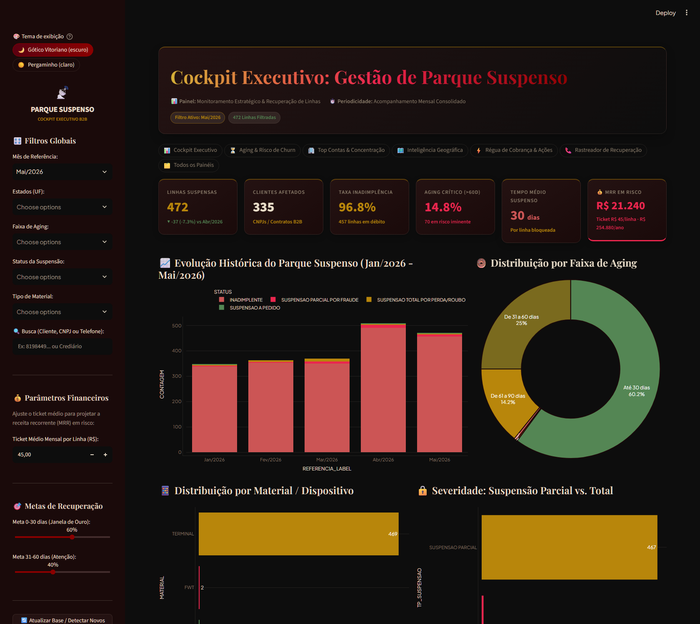<br><sub>📊 <b>Cockpit Executivo</b> — KPIs, evolução histórica e aging</sub></td>
<td width="50%">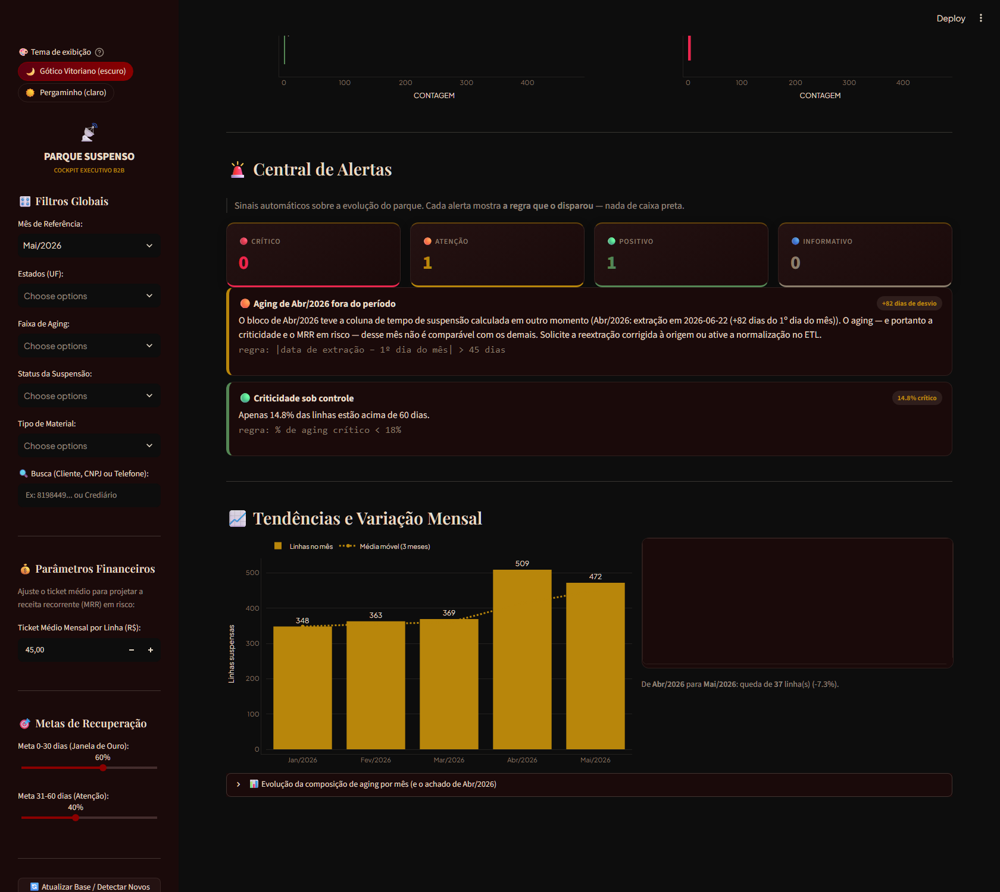<br><sub>🚨 <b>Central de Alertas</b> e <b>Tendências</b> — 9 regras auditáveis</sub></td>
</tr>
<tr>
<td width="50%">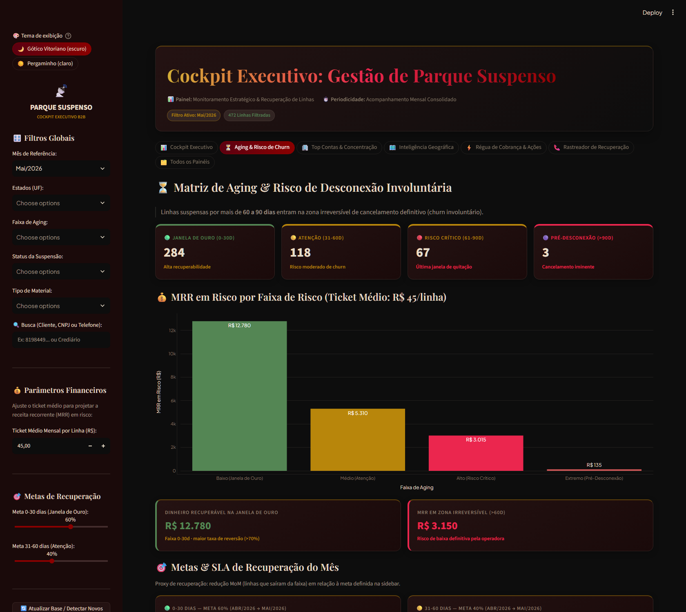<br><sub>⏳ <b>Aging &amp; Risco de Churn</b> — matriz de risco e MRR por faixa</sub></td>
<td width="50%">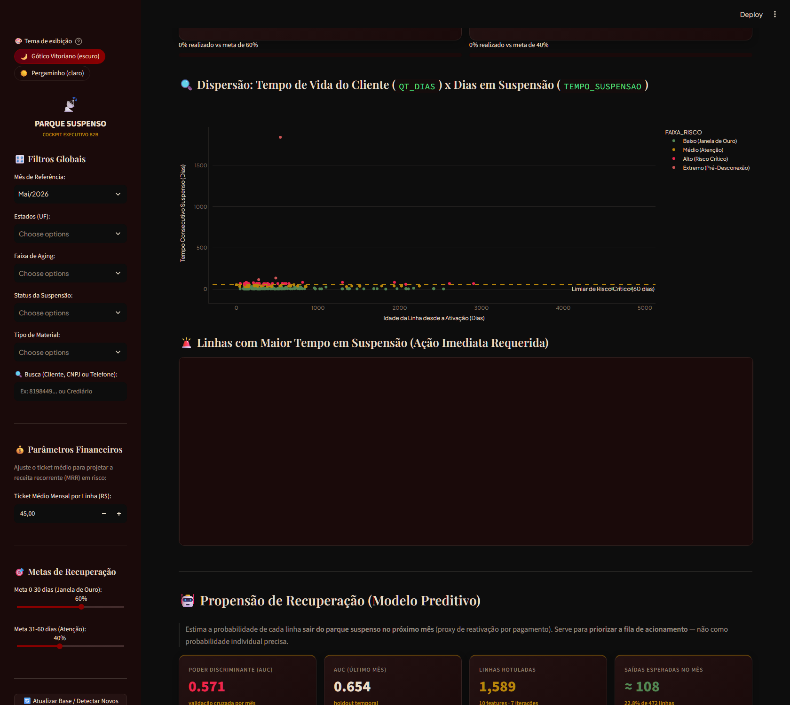<br><sub>🤖 <b>Propensão de Recuperação</b> — fila priorizada e transparência do modelo</sub></td>
</tr>
<tr>
<td width="50%">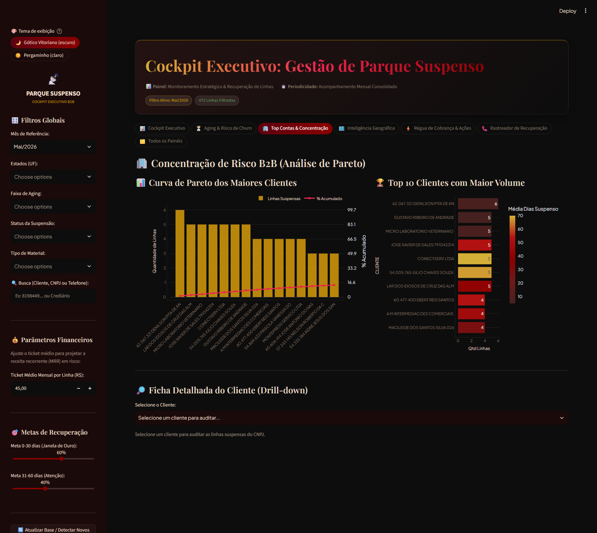<br><sub>🏢 <b>Top Contas</b> — curva de Pareto B2B</sub></td>
<td width="50%">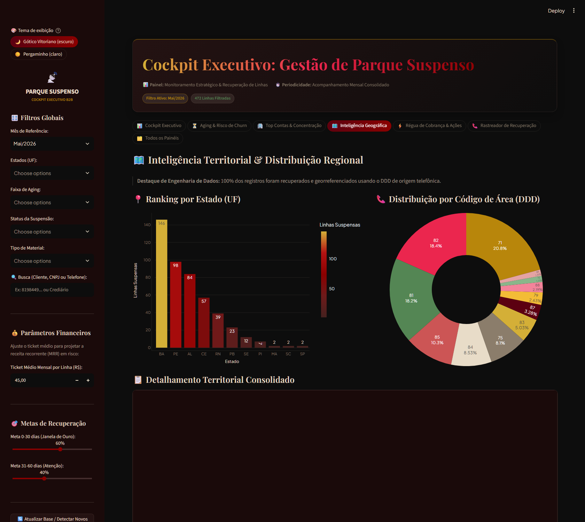<br><sub>🗺️ <b>Inteligência Geográfica</b> — ranking por UF e DDD</sub></td>
</tr>
</table>

> Todas as telas em tamanho real estão na [Seção 7 — Painéis](#sec-7).

---

## 📑 Sumário

| # | Seção | O que você encontra |
|:--:|---|---|
| ★ | [🖼️ Preview](#preview) | Galeria das telas principais do dashboard |
| 1 | [Visão Geral](#sec-1) | Problema, objetivos, escopo e glossário |
| 2 | [Status Atual](#sec-2) | Números verificados da base e do projeto |
| 3 | [🧪 Metodologia](#sec-3) | Método completo: coleta → ETL → validação → métricas → modelo → alertas |
| 4 | [🏗️ Arquitetura](#sec-4) | Componentes, fluxo de dados, contrato entre módulos |
| 5 | [🚀 Instalação e Operação](#sec-5) | 3 formas de subir, deploy como serviço, rotinas |
| 6 | [📐 Regras de Negócio](#sec-6) | Aging, faixas de risco, MRR, metas, SLA |
| 7 | [🖥️ Painéis](#sec-7) | Os 7 painéis com telas reais |
| 8 | [⚠️ Limitações](#sec-8) | Limitações de dados, método, modelo, operação e escopo |
| 9 | [🚧 Riscos e Mitigações](#sec-9) | Riscos do projeto e do produto |
| 10 | [✅ Testes e Qualidade](#sec-10) | Suíte pytest, cobertura, verificação de dados |
| 11 | [🗓️ Cronograma](#sec-11) | Linha do tempo, roadmap datado, sprints e marcos |
| 12 | [🗺️ Backlog e Roadmap](#sec-12) | Itens concluídos e pendências priorizadas |
| 13 | [🛠️ Solução de Problemas](#sec-13) | Sintoma → causa → ação |
| 14 | [🔒 Segurança e Privacidade](#sec-14) | Anonimização, logs, dados sensíveis |
| 15 | [📝 Logs e Diagnóstico](#sec-15) | Onde olhar quando algo falha |
| 16 | [🤝 Contribuição](#sec-16) | Regras invioláveis e fluxo de trabalho |
| 17 | [📚 Documentação Relacionada](#sec-17) | Mapas de leitura por público |

---

<a id="sec-1"></a>

## 1. Visão Geral

### 1.1 O problema

Linhas corporativas (B2B) ficam **suspensas** por inadimplência, fraude, perda/roubo de
equipamento ou pedido do próprio cliente. Cada linha suspensa é **receita recorrente em risco**
e, a partir de certainos dias, vira **churn involuntário**: o contrato é cancelado
definitivamente pela operadora.

O gestor de contas precisa responder, mensalmente, a três perguntas:

1. **Quanto** está suspenso e **quanto** isso representa em dinheiro?
2. **Quais linhas** devem ser acionadas **primeiro** (antes da janela irreversível)?
3. **O que mudou** desde o mês anterior — e o que piorou?

Responder isso com planilhas exige comparação manual mês a mês, o que não escala e não
deixa rastro de auditoria. Este projeto transforma a base mensal em um **cockpit
executivo auditável**, com regra explícita para cada número exibido.

### 1.2 Objetivos

| Objetivo | Como é atingido | Indicador de sucesso |
|---|---|---|
| **Visibilidade executiva** | Cockpit com 6 KPIs + evolução histórica | Consolidação mensal em < 1 min de leitura |
| **Priorização de cobrança** | Matriz de aging + modelo de propensão | Fila de acionamento ordenada por chance de recuperação |
| **Detecção de desvio** | Central de Alertas com 9 regras auditáveis | Anomalia sinalizada no mesmo dia da carga |
| **Governança de dados** | ETL com validação, dedup e anonimização | 0 colunas restritas, 0 duplicatas, falha explícita |
| **Rastreabilidade** | Rastreador nominal + log estruturado | 100% das ações de cobrança auditáveis por linha |
| **Auditoria de decisão** | PDF executivo + regra em texto em cada alerta | Número reproduzível a partir do histórico |

### 1.3 Escopo

**✅ Dentro do escopo**

- Monitoramento do parque suspenso de **linhas corporativas (B2B)**.
- Base mensal de janelas suspensas, com recorte por UF, aging, status e material.
- Enriquecimento geográfico por DDD, priorização por risco e por propensão preditiva.
- Registro de ações de cobrança e cálculo de SLA/conversão.
- Relatório executivo em PDF e exportação CSV.

**❌ Fora do escopo (não coberto por este projeto)**

- **Cobrança ativa**, emitindo contratos ou fazendo débitos (apenas **prepara e registra** a ação).
- **Integração** com ERP/CRM, core de billing ou conciliação financeira.
- **Previsão de receita** *out-of-sample* (o modelo estima **propensão por linha**, não receita).
- **Política de preços**, planos ou tarifas — o ticket médio é um **parâmetro** do gestor.
- **Operação multi-tenant**, autenticação de usuário ou trilha de auditoria por login.
- **App móvel nativo** (há apenas PWA como item de roadmap).

### 1.4 Glossário

| Termo | Significado no contexto deste projeto |
|---|---|
| **Linha** | Uma linha de telefonia corporativa suspensa. É a **unidade de análise** do projeto. |
| **Parque suspenso** | O conjunto de todas as linhas suspensas de um cliente/região/mês. |
| **Aging** | Dias desde a suspensão da linha até a data de referência do mês. |
| **Churn involuntário** | Cancelamento definitivo da linha por inadimplência, após a janela crítica. |
| **Janela de Ouro** | Faixa 0–30 dias: maior taxa de recuperação e menor custo de contato. |
| **Zona irreversível** | Faixa > 60 dias: a quitação deixa de ser realista; risco de baixa definitiva. |
| **MRR em risco** | Receita recorrente mensal potencialmente perdida pelo parque suspenso. |
| **Propensão** | Probabilidade (ordenada) de a linha sair do parque no mês seguinte. |
| **SLA de 1º contato** | Prazo-alvo, por faixa de risco, para o primeiro contato com a linha. |
| **Recuperação observada** | Saída do parque entre meses consecutivos (proxy de reativação). |
| **REFERÊNCIA** | Coluna `AAAAmm` que identifica o mês de competência de cada registro. |

---

<a id="sec-2"></a>

## 2. Status Atual

> ⚠️ Todos os números abaixo foram **reverificados contra a base tratada** em 19/10/2026
> (`parque_suspenso_tratado.parquet`, 2.061 registros) e contra a suíte de testes
> (173 testes coletados, verdes).

### 2.1 Base de dados

| Indicador | Valor | Como foi verificado |
|---|---:|---|
| Registros na base tratada | **2.061** | `len(df)` no Parquet tratado |
| Registros no arquivo de origem (pré-dedup) | 3.071 | `parquesuspenso-janeiro a maio.csv` |
| Duplicatas exatas removidas | **1.010** | ETL com `REMOVER_DUPLICATAS_EXATAS = True` |
| Meses cobertos | **5** — Jan a Mai/2026 | `REFERENCIA` ∈ {202601…202605} |
| Clientes (razão social distinta) | **821** | `CLIENTE.nunique()` |
| CNPJ distintos | **850** | `CNPJ_CLIENTE.nunique()` |
| UFs identificadas | **15** | 100% recuperadas via DDD |
| Clientes por mês | 261 · 250 · 259 · 359 · 335 | Jan → Mai |
| Duplicatas remanescentes | **0** | `df.duplicated().sum() == 0` |
| Colunas anonimizadas vazando | **0** | `DEALEAR`, `CD_DEALER`, `NOME_DIRETOR`, `NOME_DIVISAO` ausentes |

> **Nota:** a interface exibe **821** (razão social) como "clientes afetados" e o subtítulo
> diz "CNPJs / Contratos B2B". São grandezas diferentes: **850 CNPJ** distintos caem em
> **821 razões sociais** (mesmo grupo econômico, CNPJs diferentes).

### 2.2 Indicadores do parque (recorte consolidado)

| Indicador | Valor | Composição |
|---|---:|---|
| Linhas suspensas | 2.061 | — |
| Taxa de inadimplência | **96,65%** | 1.992 `INADIMPLENTE` · 34 fraude · 29 perda/roubo · 6 a pedido |
| Aging crítico (> 60 dias) | **30,81%** (635 linhas) | 534 (61–90d) · 86 (91–120d) · 15 (>120d) |
| Tempo médio suspenso | **43,9 dias** | média de `TEMPO_SUSPENSAO` |
| Material | 99,4% `TERMINAL` | 2.048 terminal · 11 FWT · 2 PEN |
| Severidade | 98,6% parcial | 2.032 `SUSPENSAO PARCIAL` · 29 `SUSPENSAO TOTAL` |
| MRR em risco (ticket R$ 45) | **R$ 92.745/mês** | R$ 1.112.940/ano projetado |

### 2.3 Evolução mensal

| Mês | Linhas | Clientes | % crítico | Tempo médio | MRR em risco | Variação MoM |
|---|---:|---:|---:|---:|---:|---:|
| Jan/2026 | 348 | 261 | 12,4% | 38,2 d | R$ 15.660 | — |
| Fev/2026 | 363 | 250 | 4,4% | 30,0 d | R$ 16.335 | +4,3% |
| Mar/2026 | 369 | 259 | 10,8% | 31,0 d | R$ 16.605 | +1,7% |
| **Abr/2026** ⚠️ | **509** | 359 | **91,6%** | 79,7 d | R$ 22.905 | +37,9% |
| Mai/2026 | 472 | 335 | 14,8% | 30,2 d | R$ 21.240 | −7,3% |

> ⚠️ **Abr/2026 não é comparável**: o bloco foi extraído em **22/06/2026** (+82 dias do 1º
> dia do mês), o que distorce o aging e infla a criticidade. Detalhado em
> [8.1 Limitações dos dados](#81-limitações-dos-dados) e [3.6.2 Consistência da extração](#362-consistência-da-extração-por-bloco-mensal).

### 2.4 Projeto

| Indicador | Valor |
|---|---|
| Painéis | **7** (Cockpit, Aging, Top Contas, Geografia, Régua, Rastreador, Todos) |
| Módulos Python | 8 (`app`, `app_data`, `etl_pipeline`, `rastreador`, `modelo_risco`, `alertas`, `relatorio_pdf`, `logging_config`) |
| Testes automatizados | **173** pytest (≈ 14 s) |
| Cobertura funcional | ETL · agregações · alertas (disparo **e** não-disparo) · modelo · rastreador · UI (`AppTest`) |
| Regras de alerta | **9**, todas com parâmetro explícito e teste |
| Modelo preditivo | AUC **0,571** (CV) · **0,654** (holdout Abr/2026) · lift **1,58×** no tercil prioritário |
| Linhas rotuladas para treino | 1.589 · 10 features · 7 iterações de Newton-Raphson |
| Rastreador | `acoes_recuperacao.csv` **ainda não criado** (nasce no 1º registro) |
| Deploy | `iniciar_dashboard.bat` (1 clique) · Docker Compose · serviço Windows (NSSM/`sc`) |
| CI/CD | `.github/workflows/test.yml` criado — **pendente de repositório remoto** |
| Licença | MIT |

---

<a id="sec-3"></a>

## 3. 🧪 Metodologia

Esta seção descreve **como** o projeto produz cada número: da origem do dado bruto até o
indicador exibido. A intenção é que qualquer resultado possa ser **auditado, reproduzido e
contestado** com base técnica.

### 3.1 Fluxo metodológico geral

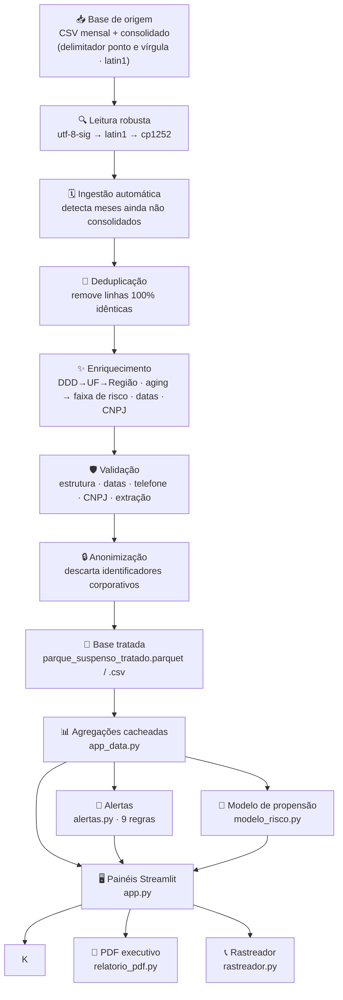

**Princípio de separação de responsabilidades:** o dashboard **não transforma dados**.
Ele consome a base tratada. Toda regra de negócio vive no ETL (`etl_pipeline.py`) ou em
`app_data.py`. Isso torna o painel **descartável e recriável** sem risco de perda de
regra, e garante que PDF, telas e relatórios usem exatamente a mesma base.

### 3.2 Coleta e consolidação da base

| Aspecto | Definição |
|---|---|
| **Granularidade** | 1 registro = 1 linha de telefonia × 1 mês de competência (`REFERENCIA` = `AAAAmm`) |
| **Origem** | Arquivos mensais `ParqueSuspenso_<mês>.csv` + consolidado `parquesuspenso-janeiro a maio.csv` |
| **Formato** | CSV delimitado por `;`, encoding legado (latin1), BOM UTF-8 opcional |
| **Chave primária de negócio** | `NUMTELEFONE` + `REFERENCIA` (telefone = identificador da linha) |
| **Chave de cliente** | `CNPJ_CLIENTE` (razão social em `CLIENTE`) |
| **Identificação de mês** | Preferência: coluna `REFERENCIA`; fallback: nome do arquivo (`MONTH_NAME_TO_NUM`) |
| **Periodicidade** | Mensal, com corte no mês de referência |

**Leitura tolerante a encoding** — `df_read_any_csv()` tenta `utf-8-sig`, depois `latin1`,
depois `cp1252`, retornando `None` (e registrando log) se nenhuma funcionar. Isso evita
que uma variação de encoding na origem derrube o pipeline inteiro.

**Ingestão automática** — `refresh_if_new_months()` compara as referências presentes no
Parquet tratado com os arquivos `ParqueSuspenso_*.csv` na pasta. Se houver mês novo, o
ETL é reexecutado e o Parquet é regravado. O mês é extraído do nome do arquivo quando a
coluna `REFERENCIA` não existe, o que torna o pipeline **agnóstico a ano e mês**.

### 3.3 Etapas do ETL

| # | Etapa | Função | Regra aplicada | Falha |
|:--:|---|---|---|---|
| 0 | **Ingestão** | `ingest_new_months()` | Anexa blocos mensais cujo `REFERENCIA` não está na base | Log; segue sem o mês |
| 0b | **Deduplicação** | `remover_duplicatas_exatas()` | Remove linhas com **todos** os campos idênticos | Log com volume por mês |
| 1 | **Telefone** | normalização | Converte para string de dígitos; extrai **DDD** (2 dígitos) | Linhas sem telefone → `NaN` |
| 2 | **UF** | enriquecimento | Recupera UF ausente a partir do DDD (tabela oficial embutida, 67 DDDs) | Sem match → permanece `NaN` |
| 3 | **Região** | enriquecimento | Agrega UF → região (Nordeste/Sudeste/Sul/Centro-Oeste/Norte) | — |
| 4 | **Aging** | padronização | Normaliza rótulos (`Até 30 dias`, `De 31 a 60 dias`, …) e define `AGING_ORDEM` | Texto irreconhecível → `Não Informado` |
| 5 | **Risco** | `classificar_risco()` | Aging → faixa de risco (4 faixas) | Idem faixa anterior |
| 6 | **Referência** | `ref_to_label()` | `202606` → `Jun/2026` (rótulo dinâmico, sem dicionário fixo) | `REFERENCIA` inválida → erro de validação |
| 7 | **Datas** | normalização | `DTPRIMEIRAATIVACAO` e `DT_SUSPENSAO` → `datetime` | Data inválida → `NaT` + alerta |
| 8 | **CNPJ** | formatação | `XX.XXX.XXX/XXXX-XX` | CNPJ nulo → alerta (não fatal) |
| 9 | **Mensagens** | enriquecimento | Integra `MSG_EXEMPLO` e `MSG_COBRANCA` da base de Janeiro | Sem match → texto padrão |
| 10 | **Anonimização** | descarte | Remove `DEALEAR`, `CD_DEALER`, `NOME_DIRETOR`, `NOME_DIVISAO` | — |
| 11 | **Validação final** | auditoria | Confere colunas obrigatórias + derivadas antes de gravar | `ETLValidationError` (fatal) |

**Constantes de governança** (topo de `etl_pipeline.py` — altere o número, rode a suíte):

| Flag | Padrão | Efeito |
|---|:---:|---|
| `REMOVER_DUPLICATAS_EXATAS` | `True` | Remove linhas 100% idênticas antes do tratamento |
| `NORMALIZAR_AGING_POR_REFERENCIA` | `False` | Recalcula o aging a partir de `DT_SUSPENSAO` + mês de referência |
| `TOLERANCIA_EXTRACAO_DIAS` | `45` | Dias tolerated entre 1º do mês e data de extração implícita |

> ⚠️ `NORMALIZAR_AGING_POR_REFERENCIA` está **desligada por padrão** de propósito: ela
> altera um indicador de negócio. A decisão é do negócio — ver [8.1](#81-limitações-dos-dados).

### 3.4 Deduplicação

**Problema observado:** o consolidado de origem carregava **Abr/2026 três vezes**
(1.519 linhas no mês, sendo apenas 509 linhas reais), inflando artificialmente o volume
e criando um "pico" que não existia.

**Critério:** remoção de registros **100% idênticos em todos os campos** — nenhuma
informação de negócio é perdida, apenas linhas repetidas byte a byte.

**Efeito:**

| Métrica | Antes | Depois |
|---|---:|---:|
| Registros totais | 3.071 | **2.061** |
| Duplicatas exatas | 1.010 | **0** |
| Abr/2026 | 1.519 (inflado) | **509 (real)** |
| Pico na regra R1 (volume > 1,5× média) | disparava indevidamente | **não dispara** |

A deduplicação é **idempotente** (executar duas vezes não muda nada — coberto por teste) e
**registra o volume removido por mês no log**, para que a perda de informação seja
rastreável, nunca silenciosa.

> O arquivo de origem foi preservado intacto em `parquesuspenso-janeiro a maio.csv.bak`,
> e uma cópia limpa (2.061 linhas) foi gerada em `parquesuspenso-janeiro a maio LIMPO.csv`.

### 3.5 Enriquecimento

**Geografia via DDD.** A base de origem trazia **227 registros sem UF**. O DDD do telefone
é um identificador geográfico confiável no Brasil; a tabela embutida cobre 67 DDDs
mapeados para as 27 UFs. O enriquecimento recuperou **100% das UFs** — incluindo
**RN (84)** e **PI (89)**, que estavam totalmente ausentes do painel antes.

**Aging → Faixa de risco.** O tempo de suspensão (`TEMPO_SUSPENSAO`) é convertido em
faixa ordinal (`AGING_ORDEM`) e depois em faixa de risco, o que dá ordenação canônica
(nunca alfabética) para gráficos e tabelas.

**Ciclo de vida da linha.** `DIAS_DESDE_ATIVACAO` (desde `DTPRIMEIRAATIVACAO`) e
`MESES_CONSECUTIVOS` (quantos meses seguidos a linha aparece) são as features que
**mais discriminam** a propensão de recuperação.

### 3.6 Qualidade de dados e validação

#### 3.6.1 Auditoria da base

`validar_base()` roda em **3 pontos** do pipeline — entrada consolidada, pós-ingestão de
novos meses e base tratada final — e cobre:

| Categoria | Verificação | Severidade |
|---|---|---|
| Estrutura | Colunas obrigatórias presentes | 🔴 Fatal (`ETLValidationError`) |
| Estrutura | Colunas derivadas presentes | 🔴 Fatal |
| Referência | Formato `AAAAmm` dentro de `[200001, 210012]` | 🔴 Fatal |
| Referência | Cada mês com **≥ 1 registro** | 🔴 Fatal |
| Data | `DT_SUSPENSAO` válida, não futura, não anterior a 2010 | 🟠 Alerta |
| Data | `DTPRIMEIRAATIVACAO` válida e anterior à suspensão | 🟠 Alerta |
| Telefone | ≥ 10 dígitos | 🟠 Alerta (R6 se > 5%) |
| CNPJ | Não nulo | 🟠 Alerta |
| Duplicatas | `df.duplicated().sum() == 0` | 🔴 Crítico (R7) |
| Extração | Data implícita de extração dentro da tolerância | 🟠 Alerta (R9) |
| Vazamento | Colunas anonimizadas ausentes | 🔴 Fatal |

#### 3.6.2 Consistência da extração por bloco mensal

**Técnica (reconhecimento de assinatura).** A coluna `TEMPO_SUSPENSAO` da origem é
calculada na **data em que o mês foi extraído**. Logo, dentro de um bloco mensal:

```
DT_SUSPENSAO + TEMPO_SUSPENSAO  =  data de extração  (constante no bloco)
```

Essa aritmética é a **assinatura** do bloco e revela a data real de extração com exatidão.
`extracoes_por_mes()` reconstrói essa data (por moda) e mede o desvio em relação ao 1º dia
do mês de referência.

| Mês | Extração reconstruída | Desvio | Situação |
|---|---:|:--:|---|
| Jan/2026 | 13/01/2026 | +12 d | ✅ |
| Fev/2026 | 06/02/2026 | +5 d | ✅ |
| Mar/2026 | 04/03/2026 | +3 d | ✅ |
| **Abr/2026** | **22/06/2026** | **+82 d** | ❌ fora do período |
| Mai/2026 | 11/05/2026 | +10 d | ✅ |

**Consequência:** Abril exibe **91,6% de aging crítico** (contra 4,4%–14,8% nos demais
meses) e tempo médio de 79,7 dias (contra 30–38 dias). **Não é evento de negócio** — é
inconsistência de extração. Como o aging alimenta a faixa de risco, a criticidade e o MRR
em risco, **os indicadores de Abril não são comparáveis**.

**Tratamento (não destrutivo, em 3 camadas):**

1. **Detecção e alerta** — `extracoes_por_mes()` + `validar_base()` + regra **R9** na Central de Alertas.
2. **Documentação na UI** — expander *"Evolução da composição de aging por mês"* no Cockpit.
3. **Correção opt-in** — `NORMALIZAR_AGING_POR_REFERENCIA = True` recalcula
   `TEMPO_SUSPENSAO`/`AGING` a partir de `DT_SUSPENSAO` (campo confiável) e do mês de
   referência, produzindo a métrica *"dias suspenso no 1º dia do mês"* — comparável entre meses.

> **Por que a correção não é o padrão:** normalizar **muda um indicador de negócio** e
> existe uma segunda leitura possível (o bloco de Abril reflete uma extração posterior,
> com suspensão de agora). A idade da suspensão por mês (`mês de referência − DT_SUSPENSAO`)
> é coerente em todos os meses, o que sustenta que os **rótulos** estão certos e o
> problema é apenas a coluna de tempo. Por isso há alerta, documentação e flag — **não** uma
> alteração silenciosa. A decisão é do negócio.

### 3.7 Anonimização e privacidade por desenho

A anonimização é aplicada **na gravação**, não na leitura: as colunas restritas nunca
chegam aos artefatos derivados.

| Coluna removida | Natureza | Onde aparece hoje |
|---|---|---|
| `DEALEAR` | Identificação do dealer | Fora da base tratada |
| `CD_DEALER` | Código do dealer | Fora da base tratada |
| `NOME_DIRETOR` | Pessoa física | Fora da base tratada |
| `NOME_DIVISAO` | Pessoa física | Fora da base tratada |

Complementos:

- **Zero credenciais** no repositório — não existe `.env`, `secrets.toml` ou chave de API.
- **Mascaramento em log** — o helper `mascarar()` ofusca telefone e CNPJ em toda mensagem
  de log (`***.****.789-**`).
- **PDF executivo** — gerado a partir da base tratada, portanto **herda** a anonimização.
- **Verificação automatizada** — teste em `tests/test_etl.py` garante que nenhuma coluna
  anonimizada sobrevive na base tratada (resultado atual: **0 colunas vazando**).

#### 3.7.1 Sanitização das mensagens de cobrança

A anonimização de colunas **não bastava**: as mensagens de cobrança trazidas da origem
continuavam citando o nome da empresa, o telefone de atendimento e nomes de
diretores/gerentes — e são exibidas no painel ⚡ Régua de Cobrança.

A sanitização roda em **duas camadas de defesa**:

| Camada | Onde | Efeito |
|---|---|---|
| **1. ETL** | `etl_pipeline.sanitizar_mensagem()` | A base tratada **nunca** contém a identificação |
| **2. Interface** | `app.py` (na exibição) | Protege bases antigas já gravadas |

| O que é substituído | Por | Onde |
|---|---|---|
| Nome da empresa (e variantes) | `Telecomunicação S/A` | Mensagens |
| Telefone de atendimento real | `(00) 00000-0000` | Mensagens |
| Nomes de diretores/gerentes | `Responsável Comercial` | Mensagens |

O ETL ainda **verifica o resultado** e registra no log se alguma mensagem escapa da
sanitização (resultado atual: *"nenhuma mensagem da base tratada identifica a
empresa"*). Testes automatizados cobrem a sanitização **e** verificam a base real em
disco.

### 3.8 Definições formais dos indicadores

Todos os indicadores do Cockpit têm definição explícita, para evitar ambiguidade entre
áreas:

| Indicador | Definição formal | Valor atual |
|---|---|---|
| **Linhas suspensas** | `count(df)` no recorte ativo | 2.061 |
| **Clientes afetados** | `nunique(CLIENTE)` (razão social) | 821 |
| **Taxa de inadimplência** | `count(STATUS == "INADIMPLENTE") / count(df)` | 96,65% |
| **Aging crítico** | `count(AGING_LIMPO ∈ {61-90d, 91-120d, >120d}) / count(df)` | 30,81% |
| **Tempo médio suspenso** | `mean(TEMPO_SUSPENSAO)` (dias) | 43,9 d |
| **MRR em risco** | `count(linhas) × ticket médio` | R$ 92.745/mês |
| **Projeção anual** | `MRR em risco × 12` | R$ 1.112.940/ano |
| **Variação MoM** | `(linhas_M / linhas_M−1 − 1) × 100` | ver 2.3 |
| **Média móvel MM3** | `rolling(window=3).mean()` do volume mensal | suaviza sazonalidade |
| **Pareto / % acumulado** | `cumsum(linhas por cliente) / total` | curva ABC |
| **Concentração top-5** | `linhas dos 5 maiores clientes / total do mês` | regra R5 |
| **Recuperação observada** | `count(linhas em M que não estão em M+1)` | proxy de reativação |

**Regra de ouro:** todo número exibido no painel pode ser **reconstruído** a partir da
base tratada com uma agregação simples. Não há número "mágico" no dashboard.

### 3.9 Metodologia do modelo preditivo de propensão

**Pergunta de negócio:** *quais linhas suspensas têm maior chance de resolver no próximo
mês e, portanto, devem ser acionadas primeiro?* O aging responde "quanto tempo já passou";
o modelo responde "quem tem chance de resolver" — o que transforma o aging em **fila de
trabalho priorizada**.

#### 3.9.1 Definição do problema

| Elemento | Definição |
|---|---|
| **Unidade de análise** | 1 linha × 1 mês de referência M |
| **Rótulo (`SAIU`)** | `1` se a linha existe em M e **não** existe em M+1; `0` se permanece suspensa |
| **Natureza do rótulo** | *Proxy* de recuperação — pode incluir cancelamento definitivo |
| **População treinável** | Pares de meses consecutivos → **1.589 linhas rotuladas** |
| **Mês-alvo** | M+1 (o modelo treina em M e estima para M+1) |

#### 3.9.2 Features (somente informação disponível em M)

| Feature | Tipo | Origem | Justificativa |
|---|---|---|---|
| `TEMPO_SUSPENSAO` | numérica | base | Dias já suspensos — o sinal mais forte de risco |
| `DIAS_DESDE_ATIVACAO` | numérica | `DTPRIMEIRAATIVACAO` | Tenure da linha — proxy de fidelidade |
| `MESES_CONSECUTIVOS` | numérica | sequência de meses | Persistência da suspensão |
| `AGING_LIMPO` | categórica (5 níveis) | base | Faixa de aging |
| `STATUS` | categórica (4 níveis) | base | Motivo da suspensão (fraude ≠ inadimplência) |

> **Prevenção de vazamento (*data leakage*).** `QT_DIAS` e `APARICOES_TOTAIS` são
> calculados para auditoria, mas **não entram** no modelo: são quase duplicatas de
> `DIAS_DESDE_ATIVACAO` (r ≈ 0,99) e `MESES_CONSECUTIVOS` (r ≈ 0,97). Mantê-las deixaria
> os coeficientes instáveis **e** vazaria informação do mês seguinte. Uma versão anterior
> do modelo **vazava** `APARICOES_TOTAIS` (contagem que inclui o mês futuro) — o bug foi
> corrigido e o teste `test_modelo_risco.py` agora **garante a ausência de vazamento**
> de forma explícita.

#### 3.9.3 Algoritmo

- **Modelo:** regressão logística com **regularização L2** (`L2_PADRAO = 1.0`, escolhido por
  validação cruzada: a diferença entre 0,25 e 3,0 é menor que o erro-padrão de 4 folds).
- **Implementação:** **NumPy puro** — sem `scikit-learn` nem `scipy`. Justificativa:
  manter a lista de dependências mínima e auditável, e permitir auditar cada passo da
  otimização.
- **Otimização:** Newton-Raphson (IRLS) com convergência em **7 iterações** (critério de
  parada sobre a norma do gradiente).
- **Pré-processamento:** padronização (z-score) das features numéricas e *one-hot*
  encoding das categóricas → **10 colunas** de entrada.
- **Calibração:** o intercepto é reajustado por **bisseção** para que a probabilidade média
  do modelo iguale a taxa de saída do mês rotulado mais recente. Corrige a superconfiança
  típica de amostras pequenas **sem alterar a ordenação** (a calibração é monotônica).
- **Prioridade:** as faixas Alta/Média/Baixa são **tercis da própria pontuação** —
  prioridade **relativa**, não limiar absoluto. Um corte fixo (ex.: 0,60) classificaria o
  mês inteiro como "Baixa", porque a taxa de saída mensal oscila entre ~23% e ~76%.

#### 3.9.4 Protocolo de validação

| Cenário | Desenho | Finalidade | Resultado |
|---|---|---|---|
| **Validação cruzada** | *Leave-one-month-out* (4 folds) | Métrica principal — usa todos os meses como teste | AUC **0,571** (min 0,419 · max 0,654) |
| **Holdout temporal** | Último mês (Abr/2026) | Teste honesto sobre o período mais recente | AUC **0,654** |
| **Calibração** | Bisseção do intercepto | Verificar monotonicidade após a calibragem | 22,8% esperado vs. 22,8% real |
| **Tercis** | Discretização em 3 grupos de tamanho igual | Verificar ganho por faixas de prioridade | lift **1,58×** no tercil alto |

**Métricas de desempate (reconhecidamente fráquíssimas, e por isso apenas informativas):**

| Métrica | Valor | Leitura |
|---|---:|---|
| Acurácia | 27,9% | **Inferior** à linha de base (77,2%) — o modelo acerta a classe minoritária (saída), não a maioria |
| Linha de base | 77,2% | Sempre predicts "não saiu" |
| Taxa base (holdout) | 22,8% | Fração de linhas que saíram |

> **Por que a acurácia é baixa e isso é esperado:** a classe positiva (linha que saiu) é
> minúscula frente às que permanecem. Um modelo que respondesse "ninguém sai" teria 77%
> de acurácia. A métrica relevante aqui é a **ordenação** (AUC/lift), não a acurácia
> de classe. O painel exibe esses números **com a explicação ao lado**, para que ninguém
> os interprete errado.

#### 3.9.5 Resultados e leitura correta

| Métrica | Valor |
|---|---:|
| AUC em validação cruzada (média) | **0,571** |
| AUC no holdout (Abr/2026) | **0,654** |
| Saída real no tercil **Alta** (170 linhas) | **35,9%** |
| Saída real no tercil **Média** (170 linhas) | 20,6% |
| Saída real no tercil **Baixa** (169 linhas) | **11,8%** |
| Lift do tercil alto | **1,58×** |

**Como ler (e como não ler):**

- ✅ **Ordena melhor que o acaso**, com poder discriminante **moderado** (0,57 > 0,50).
- ✅ É útil como **fila de priorização de trabalho**.
- ❌ **Não** é uma probabilidade calibrada de recuperação por linha.
- ❌ **Não** substitui o julgamento do analista de cobrança.
- ❌ **Não** generaliza para outras regiões sem revalidação (amostra concentrada em BA/PE/AL).

**Transparência embutida na UI** — o painel exibe, junto do resultado: AUC (CV e holdout),
hiperparâmetros usados, tabela de validação por mês, tabela de calibração por tercil com
lift observado, pesos padronizados por fator (gráfico) e um expander *"Como o modelo
funciona e quais são os limites"*.

### 3.10 Metodologia do motor de alertas

**Princípio:** todo alerta exibe **o número que o motivou** e **a regra em texto**.
Nenhum alerta é caixa preta, e cada regra tem teste de **disparo e de não-disparo**.

| # | Alerta | Nível | Regra (parâmetro) | Parâmetro |
|---|---|---|---|---|
| R1 | Pico de volume no mês | 🔴 Crítico | volume do mês > média histórica × 1,5 | `FATOR_PICO = 1.5` |
| R2 | Queda de volume no mês | 🟢 Positivo | volume do mês < média histórica × 0,8 | `FATOR_QUEDA = 0.8` |
| R3 | Alta consecutiva do parque | 🟠 Atenção | 3 variações mensais positivas seguidas | `MESES_ALTA_SEGUIDA = 3` |
| R4 | Criticidade alta no mês | 🔴 Crítico | aging crítico > 35% das linhas | `LIMITE_PCT_CRITICO = 35.0` |
| R4b | Criticidade sob controle | 🟢 Positivo | aging crítico < 18% das linhas | idem R4 |
| R5 | Concentração em poucos clientes | 🟠 Atenção | top-5 clientes > 40% das linhas do mês | `LIMITE_CONCENTRACAO = 40.0` |
| R6 | Telefones inválidos ou ausentes | 🟠 Atenção | telefones sem 10+ dígitos > 5% | `LIMITE_TELEFONE_INVALIDO = 5.0` |
| R7 | Duplicatas na base tratada | 🔴 Crítico | duplicatas exatas > 0 | — |
| R8 | Base com um único mês | 🔵 Info | menos de 3 meses na base | `MIN_MESES_TENDENCIA = 3` |
| R9 | Aging de um mês fora do período | 🟠 Atenção | data de extração > 45 dias do 1º do mês | `TOLERANCIA_EXTRACAO_DIAS = 45` |

**Níveis e ordenação:** `critico` > `atencao` > `positivo` > `info`. A Central de Alertas
mostra contadores por severidade e os cartões ordenados por gravidade.

**Série mensal de base** (`series_mensais()`) — a entrada de todas as regras: volume,
clientes, criticidade, tempo médio, MRR em risco, **variação MoM** e **média móvel de 3 meses**.

> A tolerância de extração é mantida em **sincronia** entre `alertas.py` e
> `etl_pipeline.py` — as duas constantes precisam concordar, e há teste cobrindo isso.

### 3.11 Metodologia do Rastreador de Recuperação

Fecha o ciclo entre **detecção do risco** e **recuperação efetiva**: cada contato feito
a uma linha suspensa é registrado e vira indicador de gestão.

| Indicador | Definição |
|---|---|
| **Ações registradas** | Total de contatos no histórico (append-only) |
| **Taxa de conversão** | Linhas com resultado `Recuperado` ÷ linhas acionadas |
| **1º contato (médio)** | Dias entre `DT_SUSPENSAO` (base) e a 1ª ação registrada da linha |
| **Aderência ao SLA** | % de linhas cujo 1º contato ocorreu dentro do SLA da faixa de risco |
| **MRR recuperado** | Linhas recuperadas × ticket médio (+ projeção anual) |
| **Recuperação observada** | Linhas presentes em M e ausentes em M+1 — **independe de registro manual** |

**SLA de primeiro contato por faixa de risco:**

| Faixa de risco | SLA alvo | Lógica |
|---|:---:|---|
| Baixo (Janela de Ouro) | ≤ 3 dias | Ainda há tempo e a linha é recuperável |
| Médio (Atenção) | ≤ 2 dias | Contato mais próximo do gatilho |
| Alto (Risco Crítico) | ≤ 1 dia | Última janela de quitação |
| Extremo (Pré-Desconexão) | ≤ 1 dia | Risco de baixa definitiva |

**Persistência:** arquivo `acoes_recuperacao.csv`, delimitador `;`, **UTF-8 com BOM**,
**append-only** (o histórico nunca é sobrescrito), `ID_ACAO` sequencial (`A00001`).
A leitura é **tolerante**: arquivo ausente ou parcial → o painel inicia vazio e se preenche
a cada registro. A escrita é **concorrente-segura** (arquivo temporário + replace).

**Domínio registrável:**
- **Canais:** WhatsApp · Ligação · E-mail · SMS · Visita presencial · Outro
- **Resultados:** Sem resposta · Contato efetivo · Promessa de pagamento · **Recuperado** ·
  Recusou / não paga · Número inválido

> **Contrapartida honesta do "Recuperado":** o resultado é **auto-declarado** pelo operador
> no momento do registro. Não há confirmação automática com o sistema de billing. É por
> isso que a **recuperação observada** (derivada dos meses) existe como contraprova
> independente do registro manual — as duas podem e devem divergir.

### 3.12 Reprodutibilidade e determinismo

| Garantia | Como é assegurada |
|---|---|
| **Pipeline determinístico** | Sem aleatoriedade no ETL; mesma entrada → mesma saída (teste de idempotência da dedup) |
| **Modelo reprodutível** | Newton-Raphson com inicialização fixa; sem `random_state` implícito |
| **Base versionável** | Parquet gerado pelo ETL e commitável; `acoes_recuperacao.csv` é a única fonte de histórico manual |
| **Regras auditáveis** | Parâmetros em constantes nomeadas no topo dos módulos |
| **Validação de schema** | Colunas obrigatórias e derivadas declaradas e testadas |
| **Testes herméticos** | Fixtures redirecionam escrita para `tmp_path` e fazem backup/restore do `acoes_recuperacao.csv` real |
| **CI** | `.github/workflows/test.yml` executa suíte rápida e completa a cada push/PR |

**Comando de reprodução do estado atual do dashboard:**

```bash
python etl_pipeline.py                       # regera a base tratada a partir da origem
python -m pytest -q                          # 173 testes, ~14 s
python -c "from streamlit.testing.v1 import AppTest; at=AppTest.from_file('app.py'); at.run(); print(len(at.exception))"
```

### 3.13 Governança da mudança

Regra de ouro do projeto: **mudança de regra de negócio = mudança de parâmetro + teste +
documentação**, nunca edição silenciosa de resultado.

| Tipo de mudança |Onde mexer |Obrigatório |
|---|---|---|
| Novo alerta | `alertas.py` (regra + parâmetro) | Teste de disparo **e** de não-disparo |
| Novo painel | `app.py` (`PAINEIS` + bloco) | Smoke test em `tests/test_app.py` |
| Nova agregação | `app_data.py` (função `@st.cache_data`) | Teste em `tests/test_app_data.py` |
| Nova feature do modelo | `modelo_risco.py` (`COLUNAS_*`) | Teste de ausência de vazamento + AUC |
| Nova coluna no ETL | `etl_pipeline.py` + `COLUNAS_DERIVADAS` | Teste de schema em `tests/test_etl.py` |
| Mudança de regra exibida | `README.md` + `CHANGELOG.md` | Seção atualizada |

---

<a id="sec-4"></a>

## 4. Arquitetura

### 4.1 Componentes

```
┌──────────────────────────────────────────────────────────────────────┐
│                         CAMADA DE DADOS                              │
│  origens: ParqueSuspenso_<mês>.csv · consolidado.csv                 │
│  artefatos: parque_suspenso_tratado.{parquet,csv}                    │
│             acoes_recuperacao.csv                                    │
└───────────────┬──────────────────────────────────┬───────────────────┘
                │                                  │
┌───────────────▼──────────────┐   ┌───────────────▼───────────────────┐
│     etl_pipeline.py          │   │     app_data.py                    │
│  • leitura robusta           │──▶│  • agregações cacheadas           │
│  • ingestão automática        │   │  • regras de apresentação         │
│  • deduplicação               │   │  • wrappers cacheados             │
│  • enriquecimento             │   │    (série, alertas, modelo, PDF)  │
│  • validação (validar_base)  │   └───────────────┬───────────────────┘
│  • anonimização               │                   │
└──────────────────────────────┘                   │
                                    ┌───────────────▼───────────────────┐
                                    │         app.py                    │
                                    │  7 painéis · filtros · KPIs       │
                                    │  sidebar · download · PDF         │
                                    └──┬────────┬────────┬──────────────┘
                                       │        │        │
                    ┌──────────────────▼─┐ ┌────▼─────┐ ┌▼──────────────────┐
                    │    alertas.py      │ │rastreador│ │  modelo_risco.py  │
                    │  9 regras + séries │ │  .py     │ │  log. L2 + calib. │
                    └────────────────────┘ │  SLA/KPI │ │  NumPy puro      │
                                           └──────────┘ └──────────────────┘
                    ┌────────────────────┐ ┌──────────┐
                    │  relatorio_pdf.py  │ │logging_  │
                    │  PDF A4 1 página   │ │config.py │
                    └────────────────────┘ └──────────┘
```

### 4.2 Contrato entre módulos

| Módulo | Responsabilidade | **Não** faz |
|---|---|---|
| `etl_pipeline.py` | Transformar e garantir a qualidade da base | Não formata, não renderiza |
| `app_data.py` | Agregar e formatar para exibição | Não lê arquivo diretamente |
| `app.py` | Orquestrar painéis, filtros e downloads | Não calcula regra de negócio |
| `alertas.py` | Detectar sinais sobre a série mensal | Não lê arquivo, não decide severidade de UI |
| `modelo_risco.py` | Treinar, validar e aplicar o modelo | Não conhece regras de cobrança |
| `rastreador.py` | Persistir ações e calcular SLA/conversão | Não altera a base do parque |
| `relatorio_pdf.py` | Renderizar o PDF executivo | Não consulta a base (recebe DataFrame) |
| `tema.py` | Paleta, temas, CSS dinâmico e template Plotly | Não contém regra de negócio nem dados |
| `logging_config.py` | Logging estruturado + mascaramento | Não contém regra de negócio |

### 4.3 Decisões de projeto relevantes

| Decisão | Alternativa descartada | Justificativa |
|---|---|---|
| Logística em **NumPy puro** | `scikit-learn` / `scipy` | Dependências mínimas e auditáveis; ambiente offline-friendly |
| Parquet como base primária | CSV apenas | ~10× menor e leitura instantânea; CSV mantido como fallback e artefato legível |
| Navegação com `st.pills` | `st.tabs` | `tabs` renderiza todas as abas sempre; `pills` dá lazy loading real |
| Cache por função | cache global | Invalidação granular; base nova invalida só o que depende dela |
| Deduplicação no ETL | toggle na UI | Correção permanente e automática, em vez de remendo manual |
| Normalização de aging **desligada** | sempre ativa | Altera indicador de negócio — a decisão é do negócio, não do código |
| Rótulo `SAIU` como *proxy* | dado de billing | É o único sinal de recuperação **observável** na base disponível |

---

### 3.14 Tema visual e acessibilidade (WCAG 2.1)

O tema vive **exclusivamente** em [`tema.py`](tema.py) — nenhuma cor está hard-coded no
`app.py`. Trocar ou recalibrar a identidade visual é, portanto, uma alteração em um
único lugar.

#### 3.14.1 Paleta da marca

| Elemento | Cor | Hex | Uso |
|---|---|---|---|
| Background principal | Preto carvão | `#0D0D0D` | Fundo da aplicação |
| Cards / Sidebar | Bordô escuro | `#1A0A0A` | Cartões e barra lateral |
| Acento primário | Vermelho sangue | `#8B0000` | Botões, gradiente do título, status de inadimplência |
| Acento secundário | Dourado envelhecido | `#B8860B` | Títulos, rótulos, bordas de destaque |
| Texto principal | Pergaminho | `#E8DCC8` | Títulos e valores |
| Texto secundário | Cinza ferrugem | `#8B7D6B` | Rótulos e legendas |
| Alerta / risco | Carmesim | `#DC143C` | Alertas críticos, aging > 60 dias |
| Sucesso / positivo | Verde musgo | `#2E4A2E` | Alertas positivos, aging 0–30 dias |

#### 3.14.2 Dois temas, uma identidade

| | 🌙 Gótico Vitoriano (escuro) | ☀️ Pergaminho (claro) |
|---|---|---|
| Fundo | Preto carvão `#0D0D0D` | Papel envelhecido `#F3EBDC` |
| Card | Bordô escuro `#1A0A0A` | Marfim `#FCF8EF` |
| Texto | Pergaminho `#E8DCC8` | Tinta sepia `#2A1E14` |
| Acento | Dourado `#B8860B` | Ouro escuro `#876207` |
| Rampa sequencial | `#45211F → #8B0000 → #D4AF37` | `#E5D8B6 → #B8860B → #5C0011` |
| Ideal para | Sala de controle, apresentação noturna, projeção | Impressão, relatório, ambientes claros |

A troca é feita na **sidebar** (`🎨 Tema de exibição`) e vale **imediatamente**, sem
reiniciar o servidor — o CSS é regenerado a cada rerun e os gráficos Plotly recebem as
cores do tema ativo.

> **Rampas sequenciais vitorianas:** substituem as escalas padrão do Plotly
> (`Blues`, `Teal`, `RdBu_r`, `Reds`, `Blugrn`, `Bluyl`), que introduziam azuis
> destoantes da identidade visual. A rampa é **monotônica em luminância**, o que
> preserva a leitura ordinal da escala.

#### 3.14.3 Acessibilidade: o que foi corrigido

A paleta original do briefing falhava em pontos críticos. A auditoria mediu **todos** os
pares de cor realmente usados na interface:

| Par (uso real) | Antes | Correção | Agora |
|---|---:|---|---:|
| Verde musgo como **texto** (`.delta-negative`) | 1,96:1 ❌ | variante de mesmo matiz `#548654` | **4,50:1** ✅ |
| Vermelho sangue como **texto** (faixa extrema) | 1,92:1 ❌ | variante `#CC5555` | **4,58:1** ✅ |
| Carmesim como **texto** (`.delta-positive`) | 3,85:1 ⚠️ | variante `#EB264E` | **4,51:1** ✅ |
| Verde musgo como **borda/barra** | 1,96:1 ❌ | variante `#548654` | **4,50:1** ✅ |
| Pergaminho sobre cinza ferrugem | 2,96:1 ❌ | cinza nunca usado como fundo | — |
| Ouro do PDF sobre branco | 3,25:1 ⚠️ | ouro escuro `#876207` | **4,69:1** ✅ |
| Cinza ferrugem no PDF sobre branco | 4,00:1 ⚠️ | `#817463` | **4,55:1** ✅ |

**Regra adotada:** a paleta da marca é preservada como **preenchimento, borda e acento
gráfico**; quando a cor vira **texto** sobre fundo escuro, usa-se uma variante de
**mesmo matiz e mesma saturação** com luminosidade ajustada até atingir ≥ 4,5:1.
Os contrastes são **verificados por teste automatizado** — uma regressão de cor
quebre a suíte.

| Critério WCAG 2.1 | Exigência | Status |
|---|---|:---:|
| Texto normal (≤ 18,66 px) | ≥ 4,5:1 | ✅ AA |
| Texto grande (> 18,66 px ou 14 pt bold) | ≥ 3,0:1 | ✅ AA |
| Elementos gráficos e bordas (1.4.11) | ≥ 3,0:1 | ✅ AA |
| Rampa sequencial: base distinguível do card | ≥ 1,3:1 | ✅ |
| PDF (impresso sobre papel) | ≥ 4,5:1 | ✅ AA |

> **Nota sobre cor como sinal:** os alertas da Central sempre acompanham o
> **nível por texto** (`CRÍTICO`, `ATENÇÃO`, `POSITIVO`) e a **regra em texto** — a cor
> nunca é o único meio de transmissão da informação.

---

<a id="sec-5"></a>

## 5. Instalação e Operação

### 5.0 Provisionamento dos dados (importante)

> ⚠️ **Os arquivos de dados não estão no GitHub — por decisão de segurança.**
> Nenhum `.csv`, `.xlsx` ou `.parquet` é versionado (o `.gitignore` bloqueia
> `*.csv`, `*.xlsx`, `*.xls`, `*.parquet` e afins). Um clone do repositório
> **não** traz a base: ela precisa ser **provisionada** pela área responsável.

| Arquivo | Origem | Passo |
|---|---|---|
| `ParqueSuspenso_<mês>.csv` | Extração mensal do sistema de origem | Salvar na pasta do projeto |
| `parquesuspenso-janeiro a maio.csv` | Consolidado Jan–Mai/2026 | Salvar na pasta do projeto |
| `parque_suspenso_tratado.parquet` / `.csv` | **Gerado pelo ETL** | `python etl_pipeline.py` |
| `acoes_recuperacao.csv` | Criado no 1º registro de ação | Automático |

```bash
# 1. provisionar os CSVs de origem na pasta do projeto
# 2. regenerar a base tratada
python etl_pipeline.py
# 3. subir o painel
python -m streamlit run app.py --server.port 8503
```

> O ETL é **idempotente** e detecta novos meses automaticamente, de modo que a
> operação mensal consiste em: salvar o CSV do mês → abrir o painel → conferir os
> alertas.

### 5.1 Pré-requisitos

| Item | Versão | Obrigatório |
|---|---|:---:|
| Python | 3.11+ | ✅ |
| Dependências (`requirements.txt`) | — | ✅ |
| Docker + Compose | 2.x | Opcional (recomendado em servidor) |
| PowerShell 5.1+ / `nssm.exe` | — | Opcional (serviço Windows) |

> O `.bat` é **opcional** — o projeto roda em Windows, Linux e macOS.

### 5.2 Opção 1 — 1 clique (Windows)

```bat
iniciar_dashboard.bat
```

O script verifica/instala dependências, detecta novos meses, executa o ETL se necessário e
sobe o painel em **http://localhost:8503**.

**Porta ocupada:** o script detecta que a porta já está em uso, **encerra a instância
anterior** do dashboard e segue. Se o processo não responder, orienta a usar outra porta:

```bat
iniciar_dashboard.bat 8600     # sobe em http://localhost:8600
iniciar_dashboard.bat service  # sobe como serviço do Windows
```

### 5.3 Opção 2 — manual

```bash
pip install -r requirements.txt
python etl_pipeline.py          # gera as bases tratadas
python -m streamlit run app.py --server.port 8503
```

### 5.3.1 Ambiente isolado (venv) — recomendado

Um `venv` evita conflito de versões com outros projetos da máquina:

```powershell
python -m venv venv
.\venv\Scripts\Activate.ps1
pip install -r requirements.txt        # runtime
pip install -r requirements-dev.txt    # runtime + testes
python etl_pipeline.py
python -m streamlit run app.py --server.port 8503
```

> **Versões testadas:** Python 3.11 · streamlit 1.66 · pandas 2.x/3.0 · numpy 2.4 ·
> plotly 7.1 · pyarrow 26 · reportlab 5.0. O `requirements.txt` traz **limites
> superiores** (`pandas<4`, `numpy<3`, `plotly<8`…) para evitar saltos de versão
> principal com mudanças incompatíveis. A suíte roda verde em todas elas.

### 5.4 Opção 3 — Docker (recomendada para servidor)

```bash
docker compose up -d --build
# acesse http://localhost:8503

docker compose run --rm testes   # perfil de testes
docker compose logs -f           # acompanha os logs
```

**Imagem:** multi-estágio (`base` → `runtime` → `test`), usuário **não-root** (uid 1000),
`HEALTHCHECK` no endpoint nativo `/_stcore/health`, timezone `America/Sao_Paulo`,
persistência por bind mount `./:/app`.

### 5.5 Deploy como serviço do Windows

```powershell
.\install-service.ps1              # usa NSSM se disponível, senão sc create
.\install-service.ps1 -UseSc       # força o utilitário nativo
```

| Item | Valor |
|---|---|
| Nome do serviço | `ParqueSuspenso-Dashboard` |
| Display name | `Parque Suspenso - Dashboard Executivo` |
| Inicialização | Automática |
| Porta | 8503 (`--server.headless true`) |
| Comandos | `sc stop ParqueSuspenso-Dashboard` · `sc delete ParqueSuspenso-Dashboard` |

### 5.6 Operação mensal (ritual do gestor)

| Passo | Ação | Onde |
|:--:|---|---|
| 1 | Receber o CSV do mês e salvar como `ParqueSuspenso_<mês>.csv` na pasta | Origem |
| 2 | Abrir o painel (ou `python etl_pipeline.py`) | Detecção + ingestão automáticas |
| 3 | Conferir a **Central de Alertas** | `🚨 Central de Alertas` no Cockpit |
| 4 | Conferir as **Tendências** (MoM e MM3) | `📈 Tendências e Variação Mensal` |
| 5 | Revisar a **fila priorizada** do modelo | `🤖 Propensão de Recuperação` |
| 6 | Acionar (WhatsApp/ligação) e **registrar a ação** | `⚡ Régua` + `📞 Rastreador` |
| 7 | Extrair o **PDF executivo** para a diretoria | `⚡ Régua de Cobrança & Ações` |

---

<a id="sec-6"></a>

## 6. Regras de Negócio

### 6.1 Faixas de aging

`Até 30 dias` · `De 31 a 60 dias` · `De 61 a 90 dias` · `De 91 a 120 dias` ·
`Maior que 120 dias` · `Não Informado`

### 6.2 Faixas de risco de churn

| Aging | Faixa de risco | Linhas (atual) | Leitura de negócio |
|---|---|---:|---|
| Até 30 dias | 🟢 **Baixo (Janela de Ouro)** | 964 (46,8%) | Alta recuperabilidade |
| 31 a 60 dias | 🟡 **Médio (Atenção)** | 462 (22,4%) | Risco moderado |
| 61 a 90 dias | 🔴 **Alto (Risco Crítico)** | 534 (25,9%) | Última janela de quitação |
| > 90 dias | 🟣 **Extremo (Pré-Desconexão)** | 101 (4,9%) | Cancelamento iminente |

> Linhas acima de **60–90 dias** entram na zona irreversível de cancelamento definitivo
> (churn involuntário).

### 6.3 Parâmetros executivos (sidebar)

| Parâmetro | Padrão | Faixa | Efeito |
|---|---|---|---|
| Ticket Médio Mensal por Linha | **R$ 45,00** | R$ 10 – R$ 300 | MRR em risco, projeção anual, MRR recuperado |
| Meta 0–30 dias (Janela de Ouro) | **60%** | 0–100% | Painel de metas/SLA |
| Meta 31–60 dias (Atenção) | **40%** | 0–100% | Painel de metas/SLA |

### 6.4 MRR em risco

```
MRR em risco = nº de linhas suspensas × ticket médio
```

Exibido no Cockpit (com projeção anual) e detalhado por faixa de aging no painel de Risco.

> ⚠️ O ticket médio é um **parâmetro estimado**, não um valor contratual. Ver
> [8.4 Limitações de medição](#84-limitações-de-medição-e-negócio).

### 6.5 Filtros globais

Mês de referência · UF · Faixa de aging · Status · Tipo de material · Busca livre
(cliente, CNPJ ou telefone). Todos os painéis, KPIs, gráficos e o PDF respeitam o
recorte ativo.

---

<a id="sec-7"></a>

## 7. 🖥️ Painéis do Dashboard

A navegação usa um seletor no topo: **apenas o painel ativo é renderizado** (lazy loading).
A opção **🗂️ Todos os Painéis** mostra tudo de uma vez.

| Painel | Conteúdo | Ver |
|---|---|---|
| 📊 **Cockpit Executivo** | KPIs (linhas, clientes, % inadimplência, % risco crítico, tempo médio, **MRR em risco**), evolução histórica por status, donut de aging, distribuição por material e tipo de suspensão, **🚨 Central de Alertas**, **📈 Tendências e Variação Mensal** e evolução da composição de aging por mês | [img01](assets/img01.png) · [img02](assets/img02.png) · [img03](assets/img03.png) |
| ⏳ **Aging & Risco de Churn** | Cartões por faixa de risco, **MRR em risco por faixa**, matriz de aging, dispersão *tenure × suspensão* e painel de **metas/SLA** | [img05](assets/img05.png) · [img06](assets/img06.png) |
| 🤖 **Propensão de Recuperação** | Fila priorizada de acionamento, validação por tercil, AUC por mês e pesos padronizados dos fatores | [img07](assets/img07.png) · [img08](assets/img08.png) |
| 🏢 **Top Contas & Concentração** | Análise de Pareto (curva ABC), Top clientes e **drill-down** por cliente | [img09](assets/img09.png) |
| 🗺️ **Inteligência Geográfica** | Ranking por UF, distribuição por DDD e detalhamento territorial | [img10](assets/img10.png) |
| ⚡ **Régua de Cobrança & Ações** | **Gerador de acionamento WhatsApp**, exportação CSV da base filtrada e **relatório PDF de diretoria** | — |
| 📞 **Rastreador de Recuperação** | Registro nominal das ações por linha (telefone + mês), **SLA real de 1º contato**, taxa de conversão, MRR recuperado, produtividade por canal/operador e **recuperação observada** | — |
| 🗂️ **Todos os Painéis** | Vista consolidada de todos os painéis simultâneos | — |

### 7.1 Cockpit Executivo


*KPIs do parque, evolução histórica Jan–Mai/2026 e distribuição por faixa de aging.*

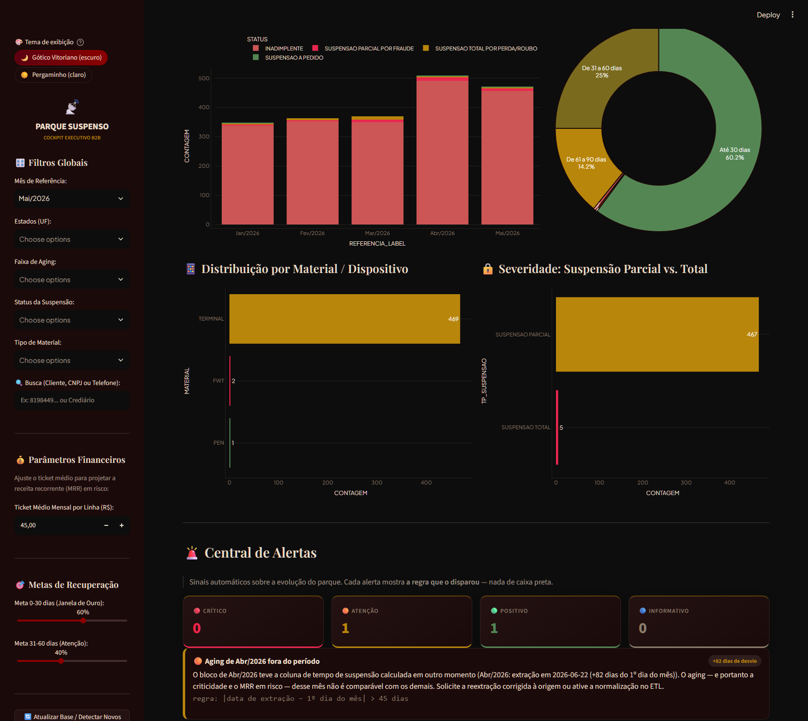

*Visão geral do cockpit: navegação por painéis no topo e filtros globais (mês, UF,
faixa de aging, status, material e busca livre) na barra lateral.*

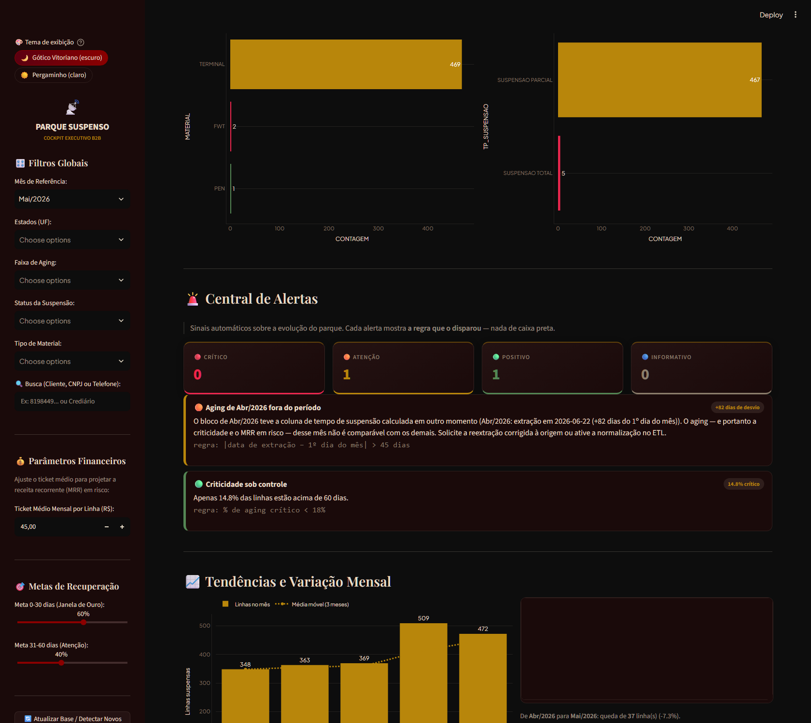

*Distribuição por material/dispositivo, severidade (suspensão parcial × total) e o
contador por severidade da Central de Alertas.*

### 7.2 Central de Alertas & Tendências


*A Central de Alertas mostra o número e a regra em texto de cada sinal; as Tendências
apresentam a variação MoM e a média móvel de 3 meses.*

### 7.3 Aging & Risco de Churn


*Matriz de aging, cartões por faixa de risco e MRR em risco por faixa.*

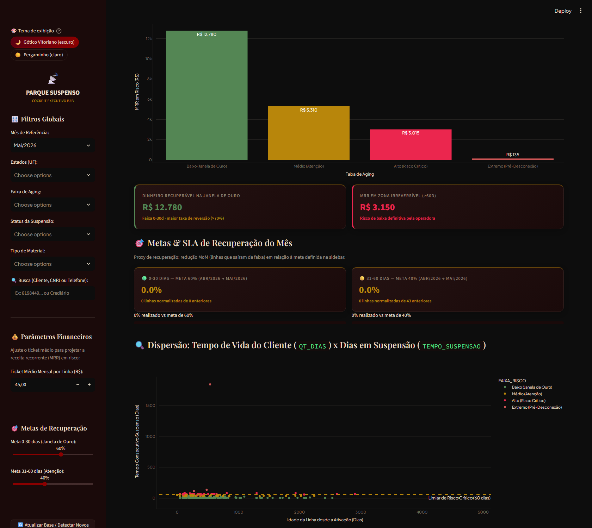

*MRR em risco por faixa, cartões de "dinheiro recuperável" vs. "zona irreversível",
painel de **Metas & SLA de Recuperação** e dispersão *tempo de vida × dias em suspensão*.*

### 7.4 Análise Preditiva — Propensão de Recuperação

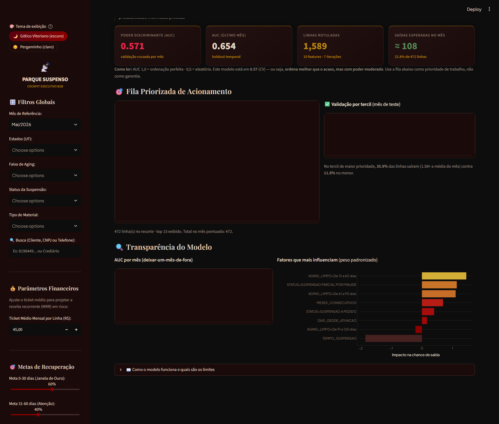

*Ranking das linhas com maior tempo em suspensão (ação imediata) e os cartões de
poder discriminante: AUC (CV), AUC (holdout), linhas rotuladas e saídas esperadas no mês.*


*Fila priorizada de acionamento, validação por tercil com lift e transparência do modelo
(AUC por mês e pesos padronizados dos fatores).*

### 7.5 Top Contas & Concentração


*Curva de Pareto e Top 10 clientes por volume de linhas suspensas.*

### 7.6 Inteligência Geográfica


*Ranking por UF (100% georreferenciado via DDD) e distribuição por código de área.*

### 7.7 Régua de Cobrança & Ações

- **Gerador de acionamento** com mensagem pronta e link direto de WhatsApp (valida o
  telefone antes de montar o link).
- **Exportação CSV** da base filtrada no recorte ativo.
- **Relatório executivo em PDF** (A4 paisagem, 1 página) para a diretoria.

### 7.8 Rastreador de Recuperação

**Como usar:**

1. Selecione o painel **📞 Rastreador de Recuperação**.
2. No formulário **➕ Registrar Ação de Recuperação**, escolha o **cliente → linha**
   (telefone · mês · faixa de risco), o **canal**, o **resultado**, o **operador** e
   (opcionalmente) o **próximo retorno** e uma observação.
3. Clique em **💾 Registrar ação**. O registro é gravado em `acoes_recuperacao.csv` e os
   indicadores são recalculados na hora.

**Estrutura de `acoes_recuperacao.csv`:**

```
ID_ACAO;DT_ACAO;NUMTELEFONE;REFERENCIA;CLIENTE;CANAL;RESULTADO;OPERADOR;DT_RETORNO;OBSERVACAO
A00001;2026-05-04 09:12:00;81985874568;202605;29.704.572 CINTIA...;WhatsApp;Contato efetivo;Ana Souza;;cliente pediu boleto
```

> **Privacidade:** o telefone é mascarado nas mensagens de log (`mascarar()`); o histórico
> local guarda o número completo por ser a chave operacional da linha.

---

<a id="sec-8"></a>

## 8. ⚠️ Limitações

Esta seção é deliberadamente **explícita e dura**. Um painel executivo que esconde as
limitações dos seus próprios números é pior do que nenhum painel. Cada limitação abaixo
é declarada, mapeada para a seção que a introduziu e — quando aplicável — acompanhada do
controle que a mitiga.

### 8.1 Limitações dos dados

| # | Limitação | Impacto | Controle / mitigação |
|---|---|---|---|
| D1 | **Aging de Abr/2026 fora do período** (extração em 22/06/2026, +82 dias) | Criticidade do mês inflada para **91,6%**; MRR e % crítico de Abril **não comparáveis** | Alerta R9 na Central; expander na UI; flag `NORMALIZAR_AGING_POR_REFERENCIA` (opt-in) |
| D2 | **Janela de 5 meses apenas** | Tendência, sazonalidade e modelo preditivo operam com base curta | Mínimos exigidos no cálculo (R8); métricas sempre acompanhadas do nº de meses |
| D3 | **O arquivo de origem ainda contém as 1.010 duplicatas** | Quem consumir o CSV direto vê volume inflado | ETL neutraliza automaticamente; cópia limpa gerada (`... LIMPO.csv`); original preservado em `.bak` |
| D4 | **Ausência de valor contratual** na base | MRR em risco é **estimado** por um ticket médio configurável | Ticket médio é parâmetro explícito e visível na sidebar |
| D5 | **Sem dado de pagamento/baixa** | Não é possível distinguir recuperação de cancelamento | "Recuperado" é auto-declarado; existe a **recuperação observada** como contraprova |
| D6 | **Telefone é o identificador da linha** | Troca de número, portabilidade ou compartilhamento de titularidade geram ambiguidade | Normalização de dígitos; alerta R6 para telefones inválidos |
| D7 | **Cobertura geográfica concentrada** (BA, PE, AL, CE lideram) | Resultado geográfico não generaliza para o restante do país | Enriquecimento 100% por DDD, mas sem ponderação por representatividade |
| D8 | **Campos corporativos removidos na origem** | Não é possível auditar por dealer/diretor/divisão | Anonimização deliberada (política de privacidade) — ver 3.7 |
| D9 | **`REFERENCIA` pode não bater com a data real de extração** | Já ocorreu em 1 de 5 blocos | Detecção por assinatura temporal (3.6.2) + alerta R9 |
| D10 | **Sem registro de auditoria por usuário** | Não se sabe *quem* aplicou um filtro ou exportou um PDF | Fora do escopo declarado; ver 1.3 |

### 8.2 Limitações metodológicas

| # | Limitação | Impacto | Controle |
|---|---|---|---|
| M1 | **A regra de deduplicação é 100% idêntica** | Linhas com mesmo cliente e mesmo telefone, mas campos diferentes, **permanecem** (decisão deliberada — são débitos distintos) | Volume removido registrado por mês no log |
| M2 | **UF derivada do DDD** (não do endereço fiscal) | Número de celular/**portabilidade** pode induzir erro de georreferenciamento | 100% de cobertura, mas a origem é telefônica — declarada no painel |
| M3 | **Enriquecimento por DDD é unidirecional** | Não há como *desenriquecer* quando a UF real divergir do DDD | A coluna `UF_ORIGINAL` é preservada para auditoria comparativa |
| M4 | **Aging usa `TEMPO_SUSPENSAO` da origem** | Depende da data de extração, que já falhou uma vez | Detecção de consistência (3.6.2) + normalização opt-in |
| M5 | **Faixas de risco são regras fixas** | Não se auto-ajustam à taxa de recuperação real por faixa | Calibração é manual, via revisão trimestral de parâmetros |
| M6 | **Ticket médio é global** | Clientes de porte muito diferente são tratados igual | Rastreabilidade de ticket médio por cliente é item de backlog |

### 8.3 Limitações do modelo preditivo

| # | Limitação | Impacto | Controle |
|---|---|---|---|
| P1 | **AUC de ~0,57 (CV)** | Poder discriminante **moderado** — não separa bem os casos difíceis | exibido de forma explícita na UI; uso restrito a ordenação |
| P2 | **Rótulo `SAIU` é *proxy*** | "Saiu do parque" inclui cancelamento definitivo | Declarado no painel e na documentação do modelo |
| P3 | **Taxa de saída mensal oscila (~23% a ~76%)** | Modelo não "acerta" a taxa do mês; a calibração só ajusta a média | Prioridade por **tercis**, nunca por limiar absoluto |
| P4 | **Acurácia (27,9%) é inferior à linha de base (77,2%)** | Perceptível e potencialmente enganoso se lido sem contexto | Exibida **com a explicação** ao lado, na mesma tela |
| P5 | **Amostra concentrada em uma região/UF** | Baixa generalização geográfica | Declarado como limite explícito do modelo |
| P6 | **Ausência de features de cobrança** (valor, contrato, histórico de pagamento) | O modelo não sabe quanto vale a linha nem se o cliente já pagou antes | Item de backlog: enriquecimento com ERP/billing |
| P7 | **Colinearidade** entre `DIAS_DESDE_ATIVACAO`, `QT_DIAS` e `MESES_CONSECUTIVOS` | Coeficientes instáveis se todos entrassem | `QT_DIAS` e `APARICOES_TOTAIS` **excluídos** por decisão documentada (r ≈ 0,97–0,99) |
| P8 | **Risco de vazamento (data leakage)** | Já causou bug real na versão anterior | Teste automatizado garante ausência de features do mês futuro |
| P9 | **Re-treino automático invalida o cache** | Aproximadamente 1–2 s de recálculo quando entra mês novo | Cache por base completa; aceitável no uso mensal |

### 8.4 Limitações de medição e negócio

| # | Limitação | Impacto | Controle |
|---|---|---|---|
| N1 | **"Recuperado" é auto-declarado** | Conversão e MRR recuperado podem ser superestimados | Confronto com a **recuperação observada** (independente do registro) |
| N2 | **MRR em risco não é receita perdida** | É **exposição** — nem toda linha suspensa vira churn | Nome do indicador explícito; ticket médio parametrizado |
| N3 | **% de inadimplência (96,65%) é tautológico** | A base é, por definição, o parque suspenso | Usado como referência de composição (status), não como KPI de performance |
| N4 | **SLA de 1º contato mede o registro, não a resposta** | Não mede se o cliente realmente atendeu | "Contato efetivo" × "Recuperado" separado na análise de resultado |
| N5 | **Não há meta de recuperação por cliente** | O painel de metas é por faixa de aging, não por carteira | Rastreabilidade de meta por cliente é item de backlog |
| N6 | **Custo de cobrança não é conhecido** | O MRR em risco não é conciliado com o custo de acionar | Fora do escopo declarado |

### 8.5 Limitações operacionais e de engenharia

| # | Limitação | Impacto | Controle |
|---|---|---|---|
| O1 | **Sem autenticação** | Qualquer pessoa com acesso à porta 8503 usa o painel | Restringir a rede / proxy reverso com auth no deploy |
| O2 | **Escalabilidade vertical** | O modelo é retreinado a cada base nova; não há escala horizontal | Suficiente para ~2 mil linhas; reavaliar acima de ~50 mil |
| O3 | **CI/CD inativo** | O workflow existe mas o repositório remoto ainda não foi criado | Documentado como pendência em [11.4](#114-cronograma-das-próximas-entregas) |
| O4 | **Estado local em CSV** | `acoes_recuperacao.csv` não tem controle de concorrência entre usuários | Adequado para 1 analista; migrar para banco em caso de multiusuário |
| O5 | **Rastreador ainda não alimentado** | Os indicadores de conversão/SLA estão vazios até o 1º registro | O arquivo nasce no 1º registro; piloto previsto no cronograma |
| O6 | **Sem backup automático da base tratada** | O Parquet é regenerável pelo ETL, mas o histórico manual **não** | Copiar `acoes_recuperacao.csv` junto com o backup da pasta |
| O7 | **PDF com 1 página** | Com muitos filtros, o PDF pode ficar denso | Layout A4 paisagem validado; ajuste sob demanda |
| O8 | **Python 3.11+** | Não roda em 3.9/3.10 sem ajustes | Declarado nos requisitos |

### 8.6 Limitações de segurança e privacidade

| # | Limitação | Impacto | Controle |
|---|---|---|---|
| S1 | **LGPD e dado de pessoa física** | Nome do cliente é a razão social, mas telefones e CNPJ são dados identificáveis | Mascaramento em log; anonimização de campos corporativos; base local |
| S2 | **`acoes_recuperacao.csv` guarda o número completo** | Necessário como chave operacional da linha | Arquivo local, append-only, fora do versionamento (`.gitignore`) |
| S3 | **Sem trilha de auditoria de acesso** | Não é possível provar quem abriu o painel | Fora do escopo declarado (1.3) |
| S4 | **Dependências de terceiros** | Streamlit/pandas/pyarrow são superfícies de dependência | Versões mínimas fixadas em `requirements.txt` |
| S5 | **Execução local por padrão** | Sem hardening de rede | Deploy em rede interna controlada ou proxy com TLS |

### 8.7 O que este projeto **não** afirma

Para evitar leitura equivocada em apresentações para a diretoria:

- ❌ Não prevê receita. **Estima exposição** e **ordena uma fila**.
- ❌ Não é fonte da verdade de billing — é uma **camada analítica** sobre a base do parque.
- ❌ Não mede a perda de receita: mede a **população em risco**.
- ❌ Não é automatizado: **acionar** a cobrança continua sendo humano (o painel prepara e registra).
- ❌ Não garante recuperação: o modelo indica **chance relativa**, não resultado.
- ❌ Não é multi-usuário: não há contas, permissões nem trilha de acesso.

### 8.8 Resumo das limitações por criticidade

| Criticidade | Itens | Tratamento |
|---|---|---|
| 🔴 **Alta** | D1 (aging de Abr/2026), P1 (AUC ~0,57), N1 (recuperado auto-declarado), O1 (sem autenticação) | Alerta visível na UI + decisão de negócio pendente + item de backlog |
| 🟠 **Média** | D2 (5 meses), D4 (sem valor contratual), P2 (rótulo proxy), P5 (concentração regional), O3 (CI inativo) | Declaradas na UI e no README; dependem de dado/infra externo |
| 🟡 **Baixa** | D3, D6, D8, D10, M1, M2, M5, M6, N3, N4, N5, N6, O2, O4, O6, O7, O8, S1–S5 | Aceitas como trade-offs documentados |

---

<a id="sec-9"></a>

## 9. 🚧 Riscos e Mitigações

| # | Risco | Prob. | Impacto | Mitigação | Responsável |
|---|---|:---:|:---:|---|---|
| R-01 | Decisão sobre o aging de Abr/2026 não é tomada | 🔴 Alta | 🔴 Alto | Alerta + expander + flag prontos; item nº 1 do backlog | Área de Negócio |
| R-02 | Ticket médio nunca é validado com o Financeiro | 🟡 Média | 🔴 Alto | MRR é labelled como *estimativa*; item de backlog | Analytics + Financeiro |
| R-03 | Rastreador não é usado pela operação | 🟠 Média | 🟠 Médio | Piloto com a equipe de cobrança + SLA visível por faixa | Operações |
| R-04 | Repositório remoto nunca é criado (CI inativo) | 🟠 Média | 🟡 Médio | Workflow pronto e testado; criação do repo é passo único | TI |
| R-05 | Base entra com novo problema de qualidade | 🟡 Média | 🟠 Médio | 12 auditorias no ETL + 9 regras de alerta + normalização opt-in | Analytics |
| R-06 | Uso do modelo como "previsão" em comitê | 🟠 Média | 🔴 Alto | Limitações exibidas na mesma tela do resultado; este README | Analytics |
| R-07 | Exposição do painel além da rede interna | 🟡 Média | 🔴 Alto | Deploy documentado em rede controlada ou proxy com auth | TI |
| R-08 | Crescimento da base degrada o tempo de carga | 🟢 Baixa | 🟡 Médio | Cache por função; reavaliar acima de ~50 mil linhas | Analytics |
| R-09 | Perda do `acoes_recuperacao.csv` | 🟢 Baixa | 🔴 Alto | Incluir no backup da pasta; documentado em 8.5/O6 | TI |
| R-10 | Divergência entre PDF e tela | 🟢 Baixa | 🟡 Médio | Ambos consomem a mesma base tratada e o mesmo recorte | Analytics |

---

<a id="sec-10"></a>

## 10. ✅ Testes e Qualidade

### 10.1 Suíte automatizada (pytest)

```bash
pip install -r requirements-dev.txt
python -m pytest                # 173 testes, ~14 s
python -m pytest -m "not ui"     # só os rápidos (sem AppTest)
python -m pytest --collect-only  # apenas listar (1,2 s)
```

### 10.2 Cobertura por arquivo

| Arquivo | Cobertura | Testes |
|---|---|---:|
| `tests/test_etl.py` | `validar_base()` (fatal e não-estrito), deduplicação idempotente, helpers de domínio, consistência da extração (`extracoes_por_mes`, `descrever_extracao`), normalização de aging, ausência de colunas anonimizadas | 28 |
| `tests/test_modelo_risco.py` | AUC (casos-limite), tercis, **ausência de vazamento de meses futuros**, convergência, calibração de intercepto, métricas e calibração monotônica | 28 |
| `tests/test_rastreador.py` | Persistência append-only, IDs sequenciais, validação de campos, KPIs, SLA por faixa, séries por canal/operador/semana e recuperação observada | 23 |
| `tests/test_app_data.py` | KPIs, faixas de risco, MRR por faixa, ordenação canônica, histórico mensal, Pareto de clientes, geo UF/DDD, qualidade e geração de PDF | 17 |
| `tests/test_alertas.py` | Séries mensais (MoM, média móvel, MRR), disparo **e não-disparo** de cada regra, ordenação por severidade, resumo por nível e tolerância a base vazia | 20 |
| `tests/test_sanitizacao_e_tema.py` | Sanitização de mensagens (empresa, telefone, nomes de pessoas), base real em disco, **contrastes WCAG 2.1** dos dois temas, rampas monotônicas e **regressão do bug de renderização** do botão do WhatsApp | 39 |
| `tests/test_app.py` | Smoke de UI com `AppTest`: carga inicial, os **7 painéis**, "Todos os Painéis", filtros globais, formulário do Rastreador (erro e sucesso), **troca de tema** e botão do WhatsApp | 17 |

> Total: **173 testes**. Os testes são **herméticos** — as fixtures redirecionam a
> persistência do rastreador para diretórios temporários e fazem backup/restore de
> `acoes_recuperacao.csv`, sem tocar nos dados reais.

### 10.3 Verificação de dados (executável a qualquer momento)

```bash
python -c "
import pandas as pd
df = pd.read_parquet('parque_suspenso_tratado.parquet')
assert len(df) == 2061, len(df)
assert df.duplicated().sum() == 0
assert not {'DEALEAR','CD_DEALER','NOME_DIRETOR','NOME_DIVISAO'} & set(df.columns)
assert df['UF'].notna().all() and df['UF'].nunique() == 15
print('OK:', len(df), 'linhas |', df['CLIENTE'].nunique(), 'clientes |', df['UF'].nunique(), 'UFs')
"
```

### 10.4 Smoke test manual da UI

```bash
python -c "from streamlit.testing.v1 import AppTest; at=AppTest.from_file('app.py'); at.run(); print(len(at.exception))"
```

### 10.5 Convenções de qualidade

| Aspecto | Padrão do projeto |
|---|---|
| Type hints | 100% das funções públicas de `etl_pipeline.py`, `relatorio_pdf.py`, `rastreador.py` |
| Docstrings | Presentes em toda função pública; em português |
| Idioma | Código, logs, mensagens de UI e documentação em **português** |
| Logs | `logging_config.get_logger(nome)` — nunca `print()` |
| Tratamento de erro | `log.exception()` no log + mensagem amigável na UI; traceback **só** no log |
| Nomenclatura | Funções e variáveis em `snake_case`; constantes em `SCREAMING_SNAKE_CASE` |
| Testes | Toda regra nova vem com teste de **disparo e não-disparo** |

---

<a id="sec-11"></a>

## 11. 🗓️ Cronograma

### 11.1 Linha do tempo — rodadas concluídas

Todas as rodadas abaixo foram executadas e validadas em **18–19/10/2026**.

| Rodada | Data | Entrega | Evidência de aceite |
|:--:|---|---|---|
| 1 | 18/10/2026 | ETL base + **5 painéis** (Cockpit, Aging, Top Contas, Geografia, Régua), tema dark, `iniciar_dashboard.bat` | App sobe em `localhost:8503`; 227 UFs recuperadas por DDD (RN e PI integrados) |
| 2 | 18/10/2026 | **MRR em risco** (ticket configurável), **ingestão automática** de meses, **PDF executivo** (A4 1 pág.), **metas/SLA**, correção da anonimização, `requirements.txt` | Jun/2026 simulado detectado, ingerido e removido; 5 cenários `AppTest` sem exceção |
| 3 | 19/10/2026 | **Fase 1 — Confiabilidade**: `validar_base()`, `ETLValidationError`, logging estruturado, tratamento de erros, limpeza de código morto | 6/6 testes de validação PASS; 8/8 cenários de UI PASS |
| 4 | 19/10/2026 | **Fase 2 — Performance**: `app_data.py` com cache, lazy loading (`st.pills`), `@st.fragment`, loading states | Carga ≈ 2.490 ms; troca de painel 186–815 ms; revisita com cache 182 ms |
| 5 | 19/10/2026 | **Correção do pico de Abril**: deduplicação no ETL (`REMOVER_DUPLICATAS_EXATAS`) | 3.071 → **2.061** registros; Abril 1.519 → **509**; 0 duplicatas |
| 6 | 19/10/2026 | **README** (documentação central) + limpeza do diretório (`.xlsx` vazio e `__pycache__` removidos) | Nenhum arquivo órfão; README referenciando todos os artefatos |
| 7 | 19/10/2026 | **Rastreador Nominal de Recuperação** (`rastreador.py` + painel 📞) | 9/9 cenários do painel sem exceção; SLA por faixa implementado |
| 8 | 19/10/2026 | **Suíte de testes** (`tests/`, `pytest.ini`, `requirements-dev.txt`) | 100% verde; hoje **173 testes** |
| 9 | 19/10/2026 | **Containerização** (Dockerfile multi-estágio, compose, entrypoint) | Build OK; contêiner `healthy`; escrita em bind mount validada como uid 1000 |
| 10 | 19/10/2026 | **Qualidade de código**: type hints, docstrings, `CONTRIBUTING.md`, `CHANGELOG.md` | Type hints em 100% das funções públicas auditadas |
| 11 | 19/10/2026 | **Análise preditiva** (`modelo_risco.py` + seção 🤖) | AUC ≈ 0,57 (CV) / 0,65 (holdout); lift 1,58×; bug de AUC invertida e de vazamento corrigidos |
| 12 | 19/10/2026 | **Central de Alertas** (`alertas.py`, 9 regras) + **achado de Abr/2026** detectado | 20 testes de alerta (disparo e não-disparo); detecção da extração em 22/06/2026 |
| 13 | 19/10/2026 | **CI/CD** (`.github/workflows/test.yml`), **serviço Windows** (`install-service.ps1`), **base de origem limpa** | Workflow criado; instalador com NSSM/`sc`; `LIMPO.csv` com 2.061 linhas |

### 11.2 Marco visual do cronograma

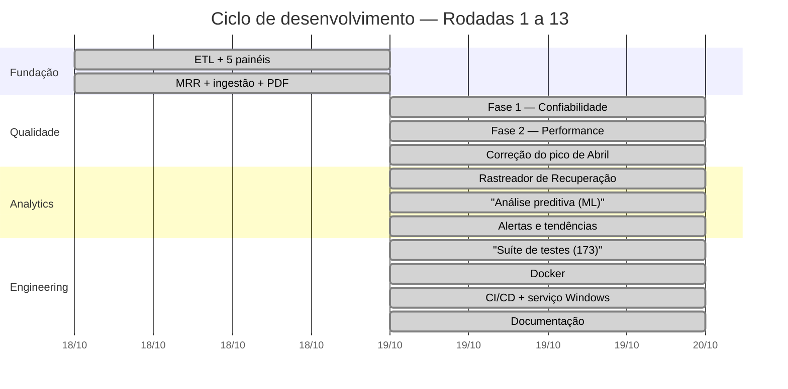

### 11.3 Roadmap por horizonte

| Horizonte | Tema | Itens | Status |
|---|---|---|---|
| **Q4 2026** | Consolidar e operacionalizar | Correções de segurança · validação e logs · cache e lazy loading · rastreador · análise preditiva · alertas e tendências · Docker e pytest | ✅ **Concluído** |
| **Q1 2027** | Decidir, calibrar e distribuir | **Decisão sobre o aging de Abr/2026** · **calibração do ticket médio com o Financeiro** · **piloto do Rastreador com a operação** · notificação ativa de alertas · deploy em rede local como serviço · CI/CD ativo em repositório remoto | 🔜 **Próximo ciclo** |
| **Q2 2027** | Escalar e integrar | PWA / acesso mobile · integração com CRM/ERP · automação de cobranças · trilha de auditoria e autenticação | 📋 **Backlog** |

### 11.4 Cronograma das próximas entregas

> ⚠️ Datas **propostas** — dependem da disponibilidade das áreas envolvidas. O gatilho de
> início de cada item está indicado para permitir replanejamento.

| Sprint | Janela (proposta) | Entrega | Área | Depende de | Critério de aceite |
|:--:|---|---|---|---|---|
| **S0** | 20–24/10/2026 | **Decisão sobre o aging de Abr/2026** (reextrair na origem × ligar `NORMALIZAR_AGING_POR_REFERENCIA`) | Negócio + Analytics | — | Decisão registrada; se opt-in, a suíte passa e o README é atualizado |
| **S1** | 27–31/10/2026 | **Calibração do ticket médio** com o Financeiro (valor por segmento/cliente) | Financeiro + Analytics | S0 | Ticket medio validado e documentado; MRR deixa de ser placeholder |
| **S2** | 03–14/11/2026 | **Piloto do Rastreador** com a equipe de cobrança (registro real de ações) | Operações | — | ≥ 1 registro por faixa de risco; indicadores de SLA e conversão alimentados |
| **S3** | 17–28/11/2026 | **Notificação ativa de alertas** (e-mail/Teams consumindo `alertas.detectar_alertas()`) | Analytics + TI | S2 | Alerta crítico chega ao canal definido em < 1 h após a carga |
| **S4** | 01–12/12/2026 | **Deploy em rede local** como serviço do Windows, com controle de acesso | TI | S1 | Serviço ativo; acesso de 2ª estação validado; regra de firewall documentada |
| **S5** | 05–22/01/2027 | **CI/CD ativo** (repositório remoto + branch protection + badge) | TI | — | Push executa a suíte completa; PR bloqueado se a suíte falhar |
| **S6** | 02–13/02/2027 | **Metas de recuperação por cliente** e trilha de metas no painel | Analytics + Negócio | S1, S2 | Meta por carteira exibida no drill-down do cliente |
| **S7** | 16–27/02/2027 | **Rastreabilidade de ticket médio por cliente** (MRR real, não estimado) | Analytics + Financeiro | S1 | MRR calculado a partir de dado contratual, com fallback ao ticket médio |
| **S8** | 01–12/03/2027 | **PWA / acesso mobile** (instalação, leitura offline do último recorte) | Analytics + TI | S4 | Painel instalável em dispositivo móvel; último recorte disponível offline |
| **S9** | 15–26/03/2027 | **Integração com CRM/ERP** (camada de leitura de contrato e pagamento) | TI + Analytics | S7, S8 | Rótulo do modelo passa a distinguir recuperação de cancelamento |
| **S10** | 29/03–10/04/2027 | **Automação de cobranças** a partir da fila priorizada (com aprovação humana) | Analytics + Operações + Compliance | S9 | Ações executadas com trilha de aprovação; nenhum acionamento sem registro |

### 11.5 Marcos de decisão (gates)

Um marco só avança quando o gate anterior é satisfeito:


| Gate | Critério para avançar |
|---|---|
| **G0** | Decisão sobre o aging de Abr/2026 registrada por escrito |
| **G1** | Ticket médio validado pelo Financeiro (S1) |
| **G2** | Rastreador com uso real por pelo menos 1 sprint (S2) |
| **G3** | Repositório remoto criado e `git init` autorizado (S5) |
| **G4** | Alinhamento sobre o que é recuperação vs. cancelamento (S9) |

### 11.6 Riscos de cronograma

| Risco | Impacto no plano | Mitigação |
|---|---|---|
| A decisão do aging (S0) se arrasta | Atrasa S1, S2 e toda a cadeia | Alerta R9 já sinaliza; o custo de adiar é **indicadores não comparáveis**, não o sistema |
| A área de Operação não adotar o Rastreador | S2–S3 perdem o insumo real | Começar com **um** analista e um canal (WhatsApp) |
| Reprograma de fim de ano (dez/2026) | S4 e S5 deslizam para janeiro | Priorizar S0 e S1, que não dependem de TI |
| Abertura do repositório remoto depende de TI | S5 fica bloqueado | Manter a suíte rodando localmente; o workflow já está pronto |
| Escopo do S10 (automação) esbarra em compliance | Aprovação manual vira gargalo | Manter a aprovação humana obrigatória desde o desenho |

### 11.7 Cadência de manutenção

| Frequência | Atividade |
|---|---|
| **Mensal** (após a carga) | Rodar o ETL, conferir alertas, revisar o PDF, registrar as ações |
| **Trimestral** | Revisar parâmetros de alerta, faixas de risco, metas e ticket médio; reavaliar as limitações deste README |
| **Semestral** | Revalidar o modelo (AUC, lift, calibração) com a base acumulada; revisar a política de anonimização |
| **Sob demanda** | Atualizar `README.md` e `CHANGELOG.md` a cada mudança de comportamento |

---

<a id="sec-12"></a>

## 12. 🗺️ Backlog e Roadmap

| Status | Prioridade | Item |
|:---:|:---:|---|
| ✅ Concluído | Alta | **Estimativa de Impacto Financeiro** — ticket médio configurável, MRR em risco no Cockpit, projeção anual e quebra por faixa |
| ✅ Concluído | Alta | **Ingestão Automática de Próximos Meses** — detecção de `ParqueSuspenso_*.csv`, reprocessamento do Parquet, eixos/filtros dinâmicos |
| ✅ Concluído | Alta | **Correção do Pico de Abril/2026** — deduplicação no ETL: 3.071 → 2.061 registros |
| ✅ Concluído | Alta | **Diagnóstico das Duplicatas de Abr/2026** — 1.010 linhas 100% idênticas (mês carregado 3×) |
| ✅ Concluído | Alta | **Validação, Logs e Tratamento de Erros (Fase 1)** — `validar_base()`, `ETLValidationError`, logging estruturado |
| ✅ Concluído | Alta | **Performance e Lazy Loading (Fase 2)** — cache granular, `st.pills`, fragments, PDF cacheado |
| ✅ Concluído | Média | **Análise Preditiva (ML)** — `modelo_risco.py`, AUC ≈ 0,57 (CV), lift 1,58× |
| ✅ Concluído | Média | **Central de Alertas & Tendências** — `alertas.py`, 9 regras auditáveis |
| ✅ Concluído | Média | **Rastreador Nominal de Recuperação** — SLA de 1º contato, conversão, recuperação observada |
| ✅ Concluído | Média | **Exportação de Relatório Executivo em PDF** — A4 paisagem, 1 página |
| ✅ Concluído | Média | **Metas e SLAs de Recuperação** — metas configuráveis + normalização MoM |
| ✅ Concluído | Baixa | **Higienização da Anonimização** — exclusão efetiva dos identificadores corporativos |
| ✅ Concluído | Baixa | **Suíte de Testes Automatizados** — 173 testes, fixtures herméticas |
| ✅ Concluído | Baixa | **Containerização (Docker)** — multi-estágio, usuário não-root, healthcheck |
| ✅ Concluído | Baixa | **Qualidade de Código e Documentação** — type hints, `CONTRIBUTING.md`, `CHANGELOG.md` |
| ✅ Concluído | Baixa | **CI/CD e serviço Windows** — workflow pronto; instalador NSSM/`sc` |
| ✅ Concluído | Alta | **Tema Gótico Vitoriano + Tema Pergaminho** — `tema.py` como fonte única, troca em tempo de execução, rampas sequenciais vitorianas no lugar das escalas azuis do Plotly |
| ✅ Concluído | Alta | **Auditoria de acessibilidade (WCAG 2.1)** — 12 falhas de contraste corrigidas (verde musgo e vermelho sangue como texto ficavam em ~1,9:1) e verificadas por teste |
| ✅ Concluído | Alta | **Sanitização de mensagens** — nome da empresa, telefone de atendimento e nomes de pessoas substituídos em duas camadas (ETL + interface) |
| ✅ Concluído | Alta | **Dados fora do versionamento** — `.gitignore` corrigido (`*.csv$` não ignorava nada) e CSVs removidos do índice do Git |
| ✅ Concluído | Média | **Correção do botão do WhatsApp** — o cartão de acionamento era renderizado como bloco de código; agora usa linha única e `st.link_button` |
| 🔜 **Pendente** | **Média** | **Decidir sobre o aging de Abr/2026** — reextrair na origem × ligar `NORMALIZAR_AGING_POR_REFERENCIA` |
| 🔜 Pendente | Média | **Calibrar o ticket médio** com o Financeiro (hoje R$ 45 é um palpite) |
| 🔜 Pendente | Média | **Piloto do Rastreador** com a operação de cobrança |
| 🔜 Pendente | Média | **Notificação ativa de alertas** (e-mail/Teams) |
| 🔜 Pendente | Baixa | **Deploy em rede local** com controle de acesso (auth) |
| 🔜 Pendente | Baixa | **CI/CD ativo** em repositório remoto (depende de `git init` autorizado) |
| 🔜 Pendente | Baixa | **Metas de recuperação por cliente** e MRR real por contrato |
| 📋 Backlog | — | PWA/app mobile · integração CRM/ERP · automação de cobranças · trilha de auditoria por usuário |

---

<a id="sec-13"></a>

## 13. 🛠️ Solução de Problemas

| Sintoma | Causa provável | Ação |
|---|---|---|
| "Não foi possível carregar os dados" | Base tratada ausente/corrompida | `python etl_pipeline.py` |
| Aviso "Base desatualizada" na sidebar | Parquet antigo com duplicatas | Reexecutar o ETL |
| "Erro ao ler arquivo" | Encoding do CSV | O ETL tenta utf-8-sig, latin1 e cp1252 automaticamente |
| PDF não gera | `reportlab` ausente | `pip install reportlab` |
| Novo mês não aparece | Nome do arquivo fora do padrão | Renomear para `ParqueSuspenso_<mês>.csv` |
| Porta 8503 ocupada | Outra instância ativa | `iniciar_dashboard.bat` **encerra a instância anterior** automaticamente; manualmente: `netstat -ano \| findstr :8503` e `taskkill /PID <pid> /F`, ou use outra porta (`iniciar_dashboard.bat 8600`) |
| "Port 8503 is not available" ao rodar `streamlit run` direto | Instância antiga do painel ainda no ar | `iniciar_dashboard.bat` (resolve sozinho) ou encerre o processo da porta |
| `ImportError` ao iniciar o app | `__pycache__` desatualizado após mudança de código | Apague `__pycache__/` e reinicie: `Remove-Item -Recurse -Force __pycache__` |
| `docker compose up` falha no build | Sem acesso à internet/proxy | O build precisa baixar `python:3.11-slim` e as dependências |
| Contêiner reinicia em loop | Falha no ETL dentro do entrypoint | `docker compose logs ParqueSuspenso` |
| Permissão negada ao gravar CSV | Bind mount com dono diferente | O compose mapeia corretamente em Docker Desktop/WSL2 (validado) |
| Rastreador "sem ações" | `acoes_recuperacao.csv` ainda não existe | Registrar a 1ª ação pelo formulário do painel |
| Erro ao registrar ação | Operador/canal/resultado inválido | O painel valida e explica o campo; operador é obrigatório |
| Linha não aparece no formulário | Recorte da sidebar sem essa linha | Trocar o mês de referência ou usar "Todos os Meses" |
| Alerta *"Aging de Abr/2026 fora do período"* | Bloco mensal com aging calculado em outro mês | Decisão de negócio: reextrair na origem **ou** ligar `NORMALIZAR_AGING_POR_REFERENCIA` |
| Central de Alertas sem cartões | Nenhum limite das regras foi atingido | Comportamento esperado — os limites estão em `alertas.py` |
| "Linhas com maior tempo em suspensão" mostra 1.883 dias | Suspensão de longa duração real (> 4 anos) | Comportamento esperado — ver [8.1](#81-limitações-dos-dados) |
| Teste falha após mexer em `alertas.py` | Constante de alerta alterada sem atualizar o teste | Os parâmetros são explícitos: ajuste o teste junto com a regra |
| `pytest` muito lento | Testes de UI (`AppTest`) incluídos | `python -m pytest -m "not ui"` para o ciclo rápido |

---

<a id="sec-14"></a>

## 14. 🔒 Segurança e Privacidade

| Aspecto | Implementação |
|---|---|
| **Identificadores corporativos** | `DEALEAR`, `CD_DEALER`, `NOME_DIRETOR`, `NOME_DIVISAO` descartados **na gravação** |
| **Nome da empresa** | Substituído por `Telecomunicação S/A` nas mensagens — em duas camadas (ETL + interface) |
| **Nomes de pessoas** | Diretores/gerentes substituídos por `Responsável Comercial` nas mensagens |
| **Telefone de atendimento** | Número real substituído por `(00) 00000-0000` nas mensagens |
| **Dados brutos** | **Nenhum `.csv`/`.xlsx`/`.parquet` versionado** — `.gitignore` + remoção do índice do Git |
| **Credenciais** | Nenhuma no repositório - sem `.env`, `secrets.toml` ou chaves de API |
| **Logs** | Telefone e CNPJ mascarados por `mascarar()` |
| **Segredos** | `.gitignore` cobre `secrets.toml`, chaves, `.env`, caches e artefatos gerados |
| **Histórico do Rastreador** | `acoes_recuperacao.csv` é local e **não versionado**; guarda o telefone porque é a chave operacional da linha |
| **Contêiner** | Usuário não-root (uid 1000), `HEALTHCHECK`, bind mount somente do diretório do projeto |
| **Autenticação** | ⚠️ **Não implementada** - ver [8.5](#85-limitações-operacionais-e-de-engenharia) (O1) |

---

<a id="sec-15"></a>

## 15. 📝 Logs e Diagnóstico

Todos os módulos registram em `logs/parque_suspenso.log` (console + arquivo rotativo
2 MB × 3 backups):

- início/fim de cada execução do ETL e volume processado;
- ingestão de novos meses e deduplicação (com detalhe por mês);
- alertas de qualidade e falhas de validação (com traceback apenas no log);
- render de painel no dashboard e geração de PDF;
- treino do modelo com métricas (rotulados, AUC CV, AUC holdout).

```powershell
Get-Content logs\parque_suspenso.log -Tail 30 -Encoding UTF8
```

Exemplo de linha do modelo:

```
2026-10-19 23:26:34 | INFO | modelo | Modelo de propensao | rotulados=1589 | AUC(CV)=0.571 | AUC(holdout=202604)=0.654 | mes alvo=202605
```

---

<a id="sec-16"></a>

## 16. 🤝 Contribuição

Leia o [`CONTRIBUTING.md`](CONTRIBUTING.md) completo. Regras invioláveis:

1. **Nunca** commitar dados brutos, credenciais ou `acoes_recuperacao.csv`.
2. Toda regra nova vem com **teste** (disparo **e** não-disparo, quando aplicável).
3. Toda mudança de comportamento visível atualiza **README** e **CHANGELOG**.
4. `print()` é proibido em produção — use `logging_config.get_logger()`.
5. Type hints e docstrings em funções públicas.
6. Nada de dependência nova sem justificar no PR (o projeto mantém o mínimo de libs).

**Fluxo sugerido:**

```bash
python -m pytest -m "not ui"    # ciclo rápido
python -m pytest                # suíte completa
```

---

<a id="sec-17"></a>

## 17. 📚 Documentação Relacionada

| Documento | Para quem | Conteúdo |
|---|---|---|
| [`README.md`](README.md) *(este)* | Todos | Visão geral, metodologia, limites, cronograma, operação |
| [`PLANO_DE_ACAO_E_STATUS.md`](PLANO_DE_ACAO_E_STATUS.md) | Negócio e gestão | Pilares estratégicos, entregas por rodada, backlog |
| [`ANALISE_E_PLANO_DE_MELHORIAS.md`](ANALISE_E_PLANO_DE_MELHORIAS.md) | Technical | Análise técnica detalhada, plano por fases, achados |
| [`CONTRIBUTING.md`](CONTRIBUTING.md) | Quem vai codar | Ambiente, padrões, testes, regras invioláveis |
| [`CHANGELOG.md`](CHANGELOG.md) | Todos | Histórico de mudanças por rodada (*Keep a Changelog*) |
| [`LICENSE`](LICENSE) | Todos | Licença MIT |

---

<div align="center">

**Cockpit Executivo — Gestão de Parque Suspenso**
Base Jan–Mai/2026 · 2.061 linhas · 821 clientes · 15 UFs · 173 testes · 7 painéis

*Documento gerado e verificado contra a base tratada em 19/10/2026.*
*Os números desta documentação foram conferidos programaticamente — ver 10.3.*

</div>
